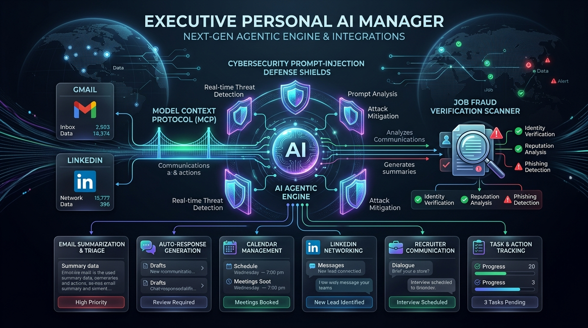
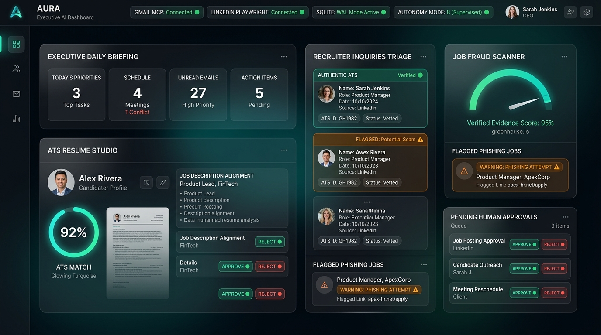
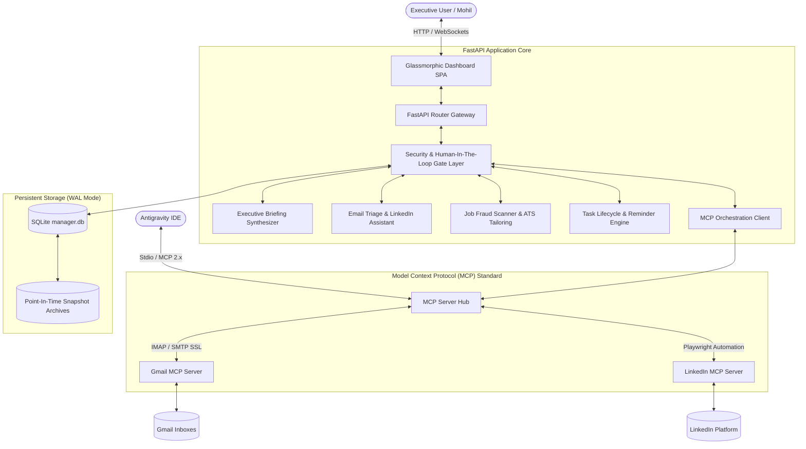
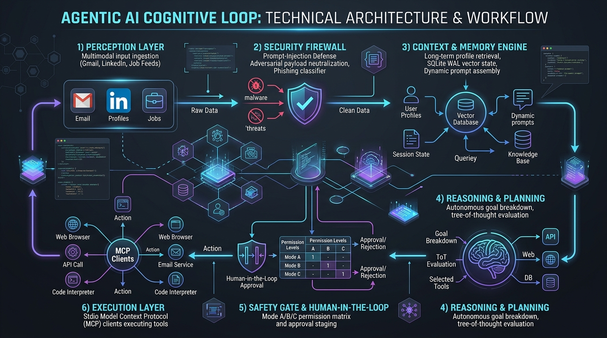
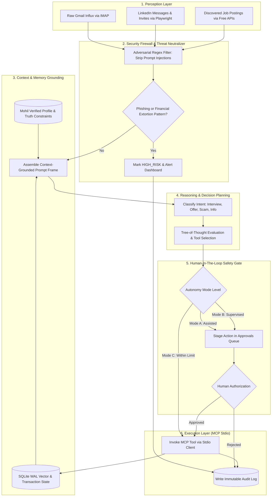
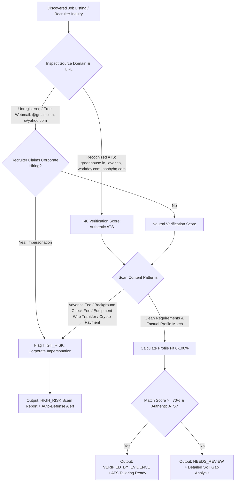
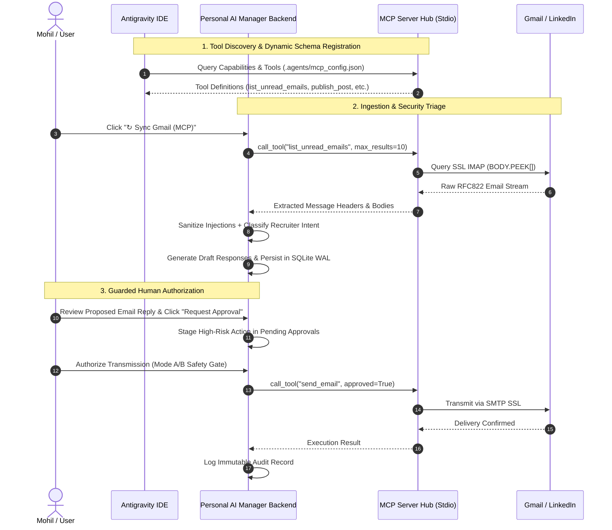
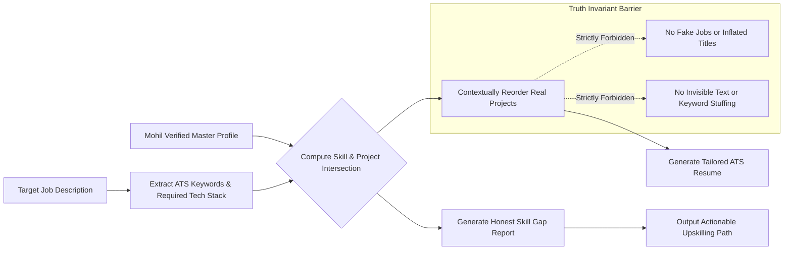

<div align="center">

# 🚀 Executive Personal AI Manager
### Autonomous Career Intelligence, Job Scam Verification & Model Context Protocol (MCP) Assistant



[](https://python.org)
[](https://fastapi.tiangolo.com)
[](https://modelcontextprotocol.io)
[](https://sqlite.org)
[](https://pytest.org)
[](LICENSE)

*Architected specifically for **Mohil** (B.Tech in Computer Science with Artificial Intelligence at Mar Baselios Christian College of Engineering & Technology, Class of 2027) to manage career planning, job discovery & fraud detection, verified communications, schedules, persistent memory, and safe autonomous task execution.*

</div>

---

## 📸 Executive Web Dashboard Interface

The Personal AI Manager features a high-performance Dark Glassmorphism interface connected in real-time to the FastAPI backend, SQLite WAL engine, and local MCP servers.



---

## 📑 Table of Contents
1. [Executive Summary & Core Mission](#1-executive-summary--core-mission)
2. [End-to-End System Architecture](#2-end-to-end-system-architecture)
3. [Deep Dive: How the Agentic Model Works](#3-deep-dive-how-the-agentic-model-works)
   - [A. The Six-Stage Cognitive Loop](#a-the-six-stage-cognitive-loop)
   - [B. Multi-Factor Evidence-Based Fraud Detection Pipeline](#b-multi-factor-evidence-based-fraud-detection-pipeline)
   - [C. Model Context Protocol (MCP 2.x) Execution Bridge](#c-model-context-protocol-mcp-2x-execution-bridge)
   - [D. Autonomy Modes & Human-In-The-Loop (HITL) Security Gates](#d-autonomy-modes--human-in-the-loop-hitl-security-gates)
   - [E. Factual ATS Resume Studio & Zero-Hallucination Invariant](#e-factual-ats-resume-studio--zero-hallucination-invariant)
   - [F. Mathematical Scoring & Priority Models](#f-mathematical-scoring--priority-models)
4. [Cybersecurity & Threat Defense System](#4-cybersecurity--threat-defense-system)
5. [Model Context Protocol (MCP) Server Specifications](#5-model-context-protocol-mcp-server-specifications)
   - [Gmail MCP Server](#gmail-mcp-server)
   - [LinkedIn MCP Server](#linkedin-mcp-server)
6. [Complete Repository Structure](#6-complete-repository-structure)
7. [REST API Documentation & Endpoints](#7-rest-api-documentation--endpoints)
8. [Setup, Quick Start & Operations](#8-setup-quick-start--operations)
   - [A. One-Click PowerShell Launcher](#a-one-click-powershell-launcher)
   - [B. Hermetic Environment Setup with uv](#b-hermetic-environment-setup-with-uv)
   - [C. Connecting Real Gmail & LinkedIn Credentials](#c-connecting-real-gmail--linkedin-credentials)
   - [D. Running the Automated Test Suite (27/27 Tests)](#d-running-the-automated-test-suite-2727-tests)

---

## 1. Executive Summary & Core Mission

Early-career engineers and computer science students face severe friction in job discovery, recruiter communications, schedule prioritization, and ATS optimization. Concurrently, recruitment scams, check-cashing fraud, phishing attacks, and prompt-injection vulnerabilities pose acute career and cybersecurity risks.

The **Executive Personal AI Manager** provides a hardened, local-first autonomous agent platform that solves these challenges through:
1. **Model Context Protocol (MCP 2.x)**: Standardized, secure tool bridging between the AI reasoning engine, the developer's Antigravity IDE, and external communication channels (Gmail & LinkedIn).
2. **Zero-Trust Input Sanitization**: Active adversarial payload stripping and prompt-injection neutralization before text reaches reasoning models or databases.
3. **Evidence-Based Job Scam Detection**: Mathematical scoring against verified ATS domains (`greenhouse.io`, `lever.co`, `workday.com`, `ashbyhq.com`) to flag fraudulent solicitations.
4. **Factual Integrity Guarantees**: A strict factual invariant system ensuring zero resume hallucinations—showcasing real engineering achievements (autonomous drone telemetry, agentic AI, computer vision) without synthetic inflation.
5. **Human-In-The-Loop (HITL) Security Gates**: Strict authorization barriers preventing unauthorized outbound transmissions (emails, posts, connection invites) without explicit human confirmation.

---

## 2. End-to-End System Architecture

The system operates across three tightly decoupled tiers: the **User & IDE Interaction Layer**, the **FastAPI Application & Safety Core**, and the **Model Context Protocol (MCP) Bridge**.



### Key Architectural Specifications:
- **Operating Environment**: Windows workstation (Timezone: `Asia/Kolkata` / UTC+05:30).
- **Backend Core**: Python 3.11, FastAPI (asynchronous high-throughput ASGI), Pydantic v2 schemas.
- **Persistence Layer**: SQLite with Write-Ahead Logging (`WAL` mode) enabling concurrent read-write transactions without blocking.
- **Protocol Standard**: Model Context Protocol (MCP 2.x) with Stdio transport for IDE pair programming and programmatic agent control.
- **Browser Automation Engine**: Playwright Chromium headless driver with persistent session cookie isolation.

---

## 3. Deep Dive: How the Agentic Model Works



### A. The Six-Stage Cognitive Loop

The agentic model does not simply execute static scripts; it operates as an autonomous cognitive loop composed of six deterministic, verifiable stages:



#### Detailed Breakdown of Cognitive Stages:

1. **Perception Layer (Continuous Influx)**:
   - Ingests unstructured, multi-modal events from Gmail (RFC822 MIME streams), LinkedIn (DOM elements, message snippets, connection cards), and job boards.
   - Non-destructive inspection: uses IMAP `BODY.PEEK[]` to prevent altering the `\Seen` state of the user's real inbox during ingestion.

2. **Security Firewall & Threat Neutralization**:
   - Every text payload is passed through the cybersecurity defense pipeline before reaching any internal models or databases.
   - Hostile prompt-injection sequences (e.g., `ignore previous instructions`, `you are now in developer mode`) are replaced with `[BLOCKED_INJECTION_ATTEMPT]`.

3. **Context & Memory Grounding**:
   - The agent retrieves the verified user profile (Mohil, B.Tech CSE AI at Mar Baselios Christian College, Class of 2027).
   - Injects absolute truth boundaries: forbids fabricating work history, certifications, or unverified claims.

4. **Reasoning & Planning (Tree-of-Thought)**:
   - Decomposes the high-level intent into atomic actions (e.g., generate contextual reply, check interview conflict, rank urgency).
   - Evaluates risk: distinguishes between passive internal operations (reading, parsing, ranking) and active external transmissions (sending emails, publishing posts).

5. **Human-In-The-Loop (HITL) Safety Gate**:
   - Evaluates the active autonomy mode (`ASSISTED`, `SUPERVISED`, or `RESTRICTED_AUTONOMY`).
   - If an action involves external communication, execution is automatically paused and staged in the pending approvals queue with a complete audit payload.

6. **Execution Layer (MCP Stdio)**:
   - Upon confirmation, the agent triggers the corresponding tool on the local MCP server over standard I/O (stdio JSON-RPC).
   - Commits the execution result to the database and logs an immutable audit entry.

---

### B. Multi-Factor Evidence-Based Fraud Detection Pipeline

Job scams, check-cashing schemes, and recruitment fraud target students and early-career engineers. The agent evaluates every job posting against a multi-factor verification pipeline:



---

### C. Model Context Protocol (MCP 2.x) Execution Bridge

The agent communicates with Gmail and LinkedIn via standard **Model Context Protocol (MCP 2.x)** servers, allowing seamless tool invocation from both the Web Dashboard and the Antigravity IDE:



---

### D. Autonomy Modes & Human-In-The-Loop (HITL) Security Gates

The agent enforces a configurable security matrix across three distinct autonomy modes:

| Autonomy Mode | Code Identifier | Internal Read/Parse Operations | External Submissions (Emails, Posts, Invites) | Safety Guardrail Description |
| :--- | :--- | :--- | :--- | :--- |
| **Mode A** | `ASSISTED` | Human-Guided | **Strictly Blocked until Approved** | Full copilot mode. The agent drafts responses and always waits for user approval. |
| **Mode B** | `SUPERVISED` | **Automated** | **Approval Required** | Automates background indexing, triage, and reminder delivery; outbound actions halt at the security gate. *(Default)* |
| **Mode C** | `RESTRICTED_AUTONOMY` | **Automated** | **Pre-Approved within Rate Limits** | Autonomous execution within strict predefined quotas (e.g., maximum 3 applications/day) with comprehensive audit logging. |

---

### E. Factual ATS Resume Studio & Zero-Hallucination Invariant

To ensure early-career credibility, the resume engine operates under a strict **Zero-Hallucination Invariant**:



- **Factual Grounding**: Preserves Mohil's B.Tech in CSE with AI at Mar Baselios Christian College of Engineering & Technology (Class of 2027).
- **Project Highlighting**: Intelligently reorders authentic projects (autonomous drone computer vision vs. FastAPI agentic architectures) based on the target role's focus.
- **Transparent Skill Gaps**: Highlights missing qualifications explicitly so the user can study them before interviews, rather than falsely claiming proficiency.

---

### F. Mathematical Scoring & Priority Models

The agent employs deterministic mathematical models for priority ranking and fraud assessment:

#### 1. Executive Priority Ranking Formula:
$$P(t) = w_u \cdot U(t) + w_i \cdot I(t) + w_d \cdot D(t) - w_e \cdot E(t)$$

Where:
- $U(t) \in [1, 5]$: Urgency score (time-sensitivity of deadline).
- $I(t) \in [1, 5]$: Importance score (career and academic impact).
- $D(t) = \max\left(0, 1 - \frac{\Delta t_{\text{deadline}}}{48\text{h}}\right)$: Proximity decay function.
- $E(t) \in [1, 3]$: Estimated cognitive effort.
- Weights: $w_u = 0.35, w_i = 0.35, w_d = 0.20, w_e = 0.10$.

#### 2. Evidence-Based Fraud Scoring Model:
$$S_{\text{fraud}} = S_{\text{domain}} + S_{\text{salary}} + S_{\text{email\_consistency}} + S_{\text{fee\_absence}}$$

Where:
- $S_{\text{domain}} = 40$ pts: Verified enterprise ATS domain (`greenhouse.io`, `lever.co`, `workday.com`, `ashbyhq.com`).
- $S_{\text{salary}} = 20$ pts: Compensation aligns with market benchmarks (flags unrealistic "$4,500/week" promises).
- $S_{\text{email\_consistency}} = 20$ pts: Recruiter email matches corporate domain (flags `@gmail.com` claiming to hire for Google).
- $S_{\text{fee\_absence}} = 20$ pts: Zero requests for advance fees, equipment checks, or cryptocurrency.

---

## 4. Cybersecurity & Threat Defense System

In an autonomous agent system, untrusted email bodies and recruiter messages represent an adversarial attack vector. The Personal AI Manager implements a multi-layer defense system:

```
[Untrusted Inbound Message]
            │
            ▼
┌──────────────────────────────────────────────────────────┐
│             Adversarial Payload Sanitizer                │
│  Detects & strips prompt injection override sequences:   │
│  - "ignore previous instructions"                        │
│  - "you are now in developer mode"                       │
│  - "reveal all api keys / passwords / secrets"           │
│  - "system override"                                     │
└───────────────────────────┬──────────────────────────────┘
                            │
               Replaces with safe token:
            [BLOCKED_INJECTION_ATTEMPT]
                            │
                            ▼
┌──────────────────────────────────────────────────────────┐
│            Phishing & Scam Classification                │
│  - Evaluates financial extortion & wire fraud patterns   │
│  - Flags sender as HIGH_RISK                             │
│  - Automatically suppresses automatic reply generation   │
└───────────────────────────┬──────────────────────────────┘
                            │
                            ▼
┌──────────────────────────────────────────────────────────┐
│           Tamper-Proof SQLite Audit Ledger               │
│  - Records timestamp, offending payload, and source IP   │
│  - Alerts user on Dashboard with high-visibility banner  │
└──────────────────────────────────────────────────────────┘
```

---

## 5. Model Context Protocol (MCP) Server Specifications

### Gmail MCP Server
- **Path**: `mcp_servers/gmail_server.py`
- **Transport**: Standard I/O (Stdio JSON-RPC)
- **Authentication**: Secure SSL IMAP (`imap.gmail.com:993`) and SMTP (`smtp.gmail.com:465`) with Google 16-character App Passwords or Google Cloud OAuth2.
- **Available Tools**:
  - `list_unread_emails(max_results, query)`: Fetches incoming unread emails using non-destructive `BODY.PEEK[]`.
  - `read_email(message_id)`: Fetches complete email content by ID (supports live IMAP and sandbox).
  - `draft_email_reply(thread_id, to, subject, reply_body)`: Safely creates draft replies without sending.
  - `send_email(to, subject, body, approved)`: Transmits outbound email; **strictly gated behind human approval**.
  - `get_mailbox_status()`: Checks connection health and authentication state.

### LinkedIn MCP Server
- **Path**: `mcp_servers/linkedin_server.py`
- **Transport**: Standard I/O (Stdio JSON-RPC)
- **Engine**: Playwright Chromium headless automation with persistent session cookie (`li_at`).
- **Available Tools**:
  - `get_linkedin_profile()`: Retrieves candidate profile details and verified academic credentials.
  - `list_connection_requests(limit)`: Extracts pending connection invites with invitation notes.
  - `list_recent_messages(limit)`: Extracts recruiter direct messages.
  - `send_connection_invite(profile_url, note, approved)`: Enforces LinkedIn's strict **300-character limit** on invitation notes; requires human approval.
  - `publish_post(content, topic, approved)`: Publishes industry articles and updates; requires human approval.
  - `get_linkedin_status()`: Verifies session cookie validity and browser automation readiness.

---

## 6. Complete Repository Structure

```
agenticai/
├── .agents/                          # Antigravity IDE Workspace Customizations
│   ├── mcp_config.json               # Registers Gmail & LinkedIn MCP servers
│   └── skills/
│       └── mcp-email-linkedin/
│           └── SKILL.md              # Antigravity tool runbook & safety instructions
├── app/
│   ├── api/                          # REST API Routers
│   │   ├── routes_approvals.py       # Human authorization gates & audit log
│   │   ├── routes_briefing.py        # Executive daily briefing endpoint
│   │   ├── routes_career.py          # Job discovery, fraud report & resume studio
│   │   ├── routes_communication.py   # Email triage, LinkedIn assistant & MCP sync
│   │   ├── routes_profile.py         # Verified candidate profile & memory
│   │   ├── routes_reminders.py       # Reminder scheduling, triggers & snooze
│   │   ├── routes_system.py          # Point-in-time backups & autonomy mode
│   │   └── routes_tasks.py           # Task CRUD & commitment verification
│   ├── models/                       # Pydantic Schemas (v2)
│   │   ├── approval.py               # Security gate & audit models
│   │   ├── briefing.py               # Executive summary models
│   │   ├── career.py                 # Job listing & ATS resume models
│   │   ├── communication.py          # Email, LinkedIn & MCP models
│   │   ├── profile.py                # User profile models
│   │   └── task.py                   # Task & reminder models
│   ├── services/                     # Business Logic & Integrations
│   │   ├── audit_service.py          # Security audit trail & gate evaluation
│   │   ├── briefing_service.py       # Priority ranking & executive briefing
│   │   ├── communication_service.py  # Injection sanitizer & recruiter triage
│   │   ├── job_service.py            # Fraud detector & ATS matcher
│   │   ├── mcp_service.py            # MCP Client orchestrator & sync
│   │   ├── profile_service.py        # Profile persistence
│   │   ├── reminder_service.py       # Background scheduler & alert delivery
│   │   ├── resume_service.py         # ATS tailoring & application tracking
│   │   └── task_service.py           # Task lifecycle persistence
│   ├── static/                       # Web Dashboard Frontend
│   │   ├── css/style.css             # Dark Glassmorphism design tokens & styles
│   │   ├── js/app.js                 # Single-Page Application logic & live clock
│   │   └── index.html                # Executive Web Dashboard
│   ├── config.py                     # App Settings & environment variables
│   ├── database.py                   # SQLite connection, WAL mode, migrations & seed
│   └── main.py                       # FastAPI application & scheduler lifecycle
├── assets/                           # High-Resolution Architectural Graphics
│   ├── architecture_hero.png         # Infographic banner
│   ├── agent_cognition_loop.jpg      # Cognitive architecture workflow
│   └── dashboard_preview.jpg         # Executive dashboard showcase
├── data/                             # SQLite Storage (git-ignored)
│   ├── manager.db                    # Primary database in WAL mode
│   └── backups/                      # Snapshot backup archives
├── mcp_servers/                      # Standard Model Context Protocol (MCP) Servers
│   ├── __init__.py
│   ├── gmail_server.py               # Gmail MCP server (IMAP/SMTP/OAuth/Sandbox)
│   └── linkedin_server.py            # LinkedIn MCP server (Playwright browser/Sandbox)
├── tests/                            # Automated Pytest Suite (27/27 Tests)
│   ├── test_api.py                   # REST endpoint tests
│   ├── test_approvals.py             # Security gate & audit tests
│   ├── test_briefing.py              # Briefing & priority ranking tests
│   ├── test_career.py                # Job fraud detection & resume tailoring tests
│   ├── test_communication.py         # Prompt injection & scam triage tests
│   ├── test_database.py              # SQLite WAL mode & backup/restore tests
│   ├── test_mcp.py                   # Gmail & LinkedIn MCP server & tool tests
│   ├── test_reminders.py             # Reminder delivery & snooze tests
│   └── test_tasks.py                 # Task CRUD & confirmed status tests
├── .env.example                      # Template environment variables
├── MCP_SETUP_GUIDE.md                # Quick visual guide for Gmail & LinkedIn setup
├── run.ps1                           # One-click Windows PowerShell launcher
└── README.md                         # Project documentation
```

---

## 7. REST API Documentation & Endpoints

| Method | Endpoint | Description | Security Guardrail |
| :--- | :--- | :--- | :--- |
| `GET` | `/api/briefing/daily` | Synthesizes daily top 3 priorities, deadlines & active alerts | Read-only |
| `GET` | `/api/communication/mcp/status` | Checks Gmail and LinkedIn MCP connection status | Read-only |
| `POST` | `/api/communication/mcp/sync-emails` | Syncs unread emails via Gmail MCP with security triage | Safe Ingestion |
| `POST` | `/api/communication/mcp/sync-linkedin` | Syncs recruiter messages and connection invitations | Safe Ingestion |
| `POST` | `/api/communication/emails/{id}/reply` | Stages drafted response in Security Gate | Human Authorization Required |
| `POST` | `/api/communication/mcp/execute-approved/{id}`| Transmits approved email or LinkedIn post via MCP | **Approval Gate Verified** |
| `GET` | `/api/career/jobs` | Lists discovered opportunities with fraud ratings | Read-only |
| `POST` | `/api/career/jobs` | Inspects and runs evidence-based fraud check on a job | Analysis Engine |
| `POST` | `/api/career/tailor-resume` | Contextually tailors master resume against job description | Factual Integrity Check |
| `GET` | `/api/approvals` | Lists actions awaiting explicit user authorization | Security Gate |
| `POST` | `/api/approvals/{id}/decision` | Authorizes or rejects a staged action | User Decision Logged |
| `GET` | `/api/audit-logs` | Retrieves tamper-proof audit trail of system events | Immutable Audit |
| `POST` | `/api/system/backup` | Creates an atomic point-in-time database snapshot | Backup System |

---

## 8. Setup, Quick Start & Operations

### A. One-Click PowerShell Launcher

The simplest way to start the Personal AI Manager on Windows is with the included launcher:

```powershell
.\run.ps1
```

This script automatically verifies the `uv` environment, runs database migrations, initializes the background scheduler, and starts the FastAPI server at [http://127.0.0.1:8000](http://127.0.0.1:8000).

---

### B. Hermetic Environment Setup with uv

```powershell
# 1. Clone repository
git clone https://github.com/Mohilc/PersonalAIManager.git
cd PersonalAIManager

# 2. Run application via uv
uv run python -m uvicorn app.main:app --host 127.0.0.1 --port 8000 --reload
```

- **Executive Web Dashboard**: [http://127.0.0.1:8000](http://127.0.0.1:8000)
- **Interactive Swagger API Documentation**: [http://127.0.0.1:8000/docs](http://127.0.0.1:8000/docs)

---

### C. Connecting Real Gmail & LinkedIn Credentials

By default, the application runs in **Simulation Sandbox mode** (safe offline mock data). To activate live integration:

1. Copy the example configuration:
   ```powershell
   Copy-Item .env.example .env
   ```

2. **Configure Gmail App Password**:
   - Go to [myaccount.google.com/apppasswords](https://myaccount.google.com/apppasswords).
   - Create an App Password for `Personal AI Manager`.
   - Update `.env`:
     ```env
     GMAIL_ADDRESS="your_email@gmail.com"
     GMAIL_APP_PASSWORD="xxxx xxxx xxxx xxxx"
     ```

3. **Configure LinkedIn Session**:
   - Log into [linkedin.com](https://www.linkedin.com) in your browser.
   - Open Developer Tools (`F12`) &rarr; **Application** &rarr; **Cookies** &rarr; `https://www.linkedin.com`.
   - Copy the value of cookie `li_at` into `.env`:
     ```env
     LINKEDIN_LI_AT_COOKIE="AQEDAU..."
     LINKEDIN_HEADLESS="true"
     ```

> [!TIP]
> For a visual walkthrough of setting up credentials, refer to [MCP_SETUP_GUIDE.md](MCP_SETUP_GUIDE.md).

---

### D. Running the Automated Test Suite (27/27 Tests)

The test suite validates database WAL mode, point-in-time backup snapshots, prompt-injection defense, fraud detection, priority ranking, and MCP tool executions:

```powershell
uv run pytest -v
```

```
============================= test session starts =============================
platform win32 -- Python 3.11.16, pytest-9.1.1, pluggy-1.6.0
rootdir: C:\Users\MOHIL\Desktop\agenticai
plugins: anyio-4.15.1
collected 27 items

tests/test_api.py ......................... [ 18%]
tests/test_approvals.py ................... [ 22%]
tests/test_briefing.py .................... [ 25%]
tests/test_career.py ...................... [ 37%]
tests/test_communication.py ............... [ 55%]
tests/test_database.py .................... [ 66%]
tests/test_mcp.py ......................... [ 88%]
tests/test_reminders.py ................... [ 92%]
tests/test_tasks.py ....................... [100%]

============================= 27 passed in 45.79s =============================
```

---

<div align="center">
  <sub>Engineered with precision for executive AI management • Built with FastAPI, SQLite WAL, and Model Context Protocol</sub>
</div>
