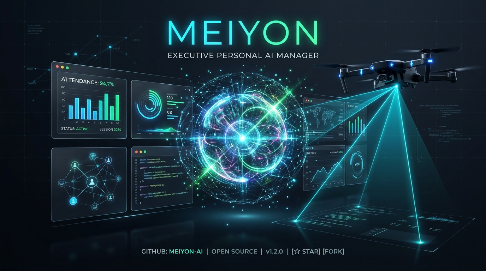
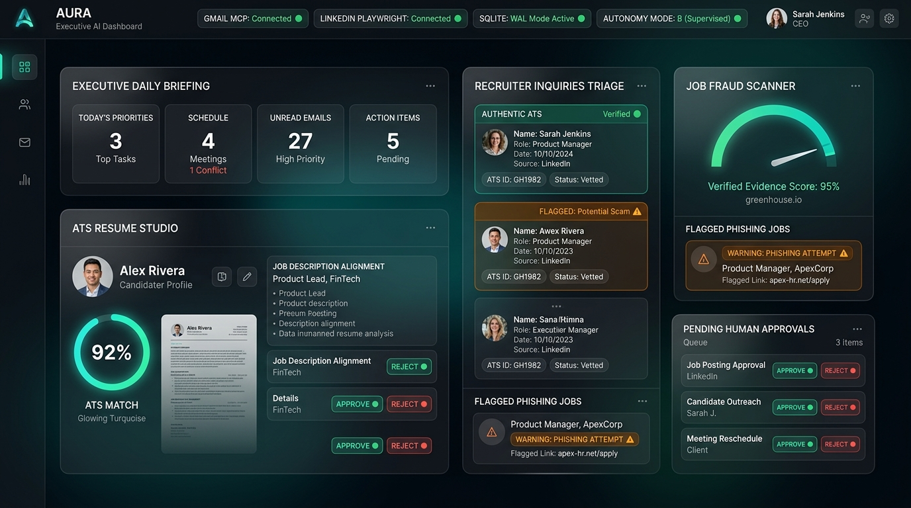
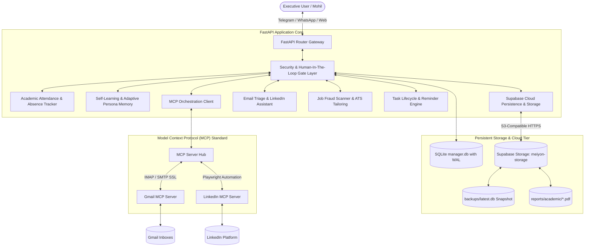
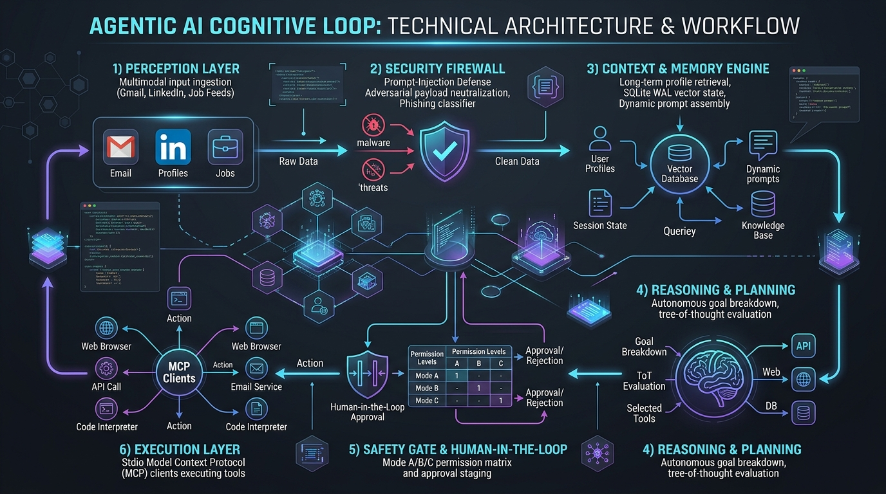
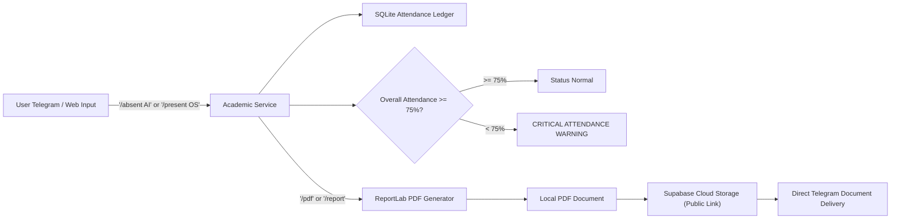
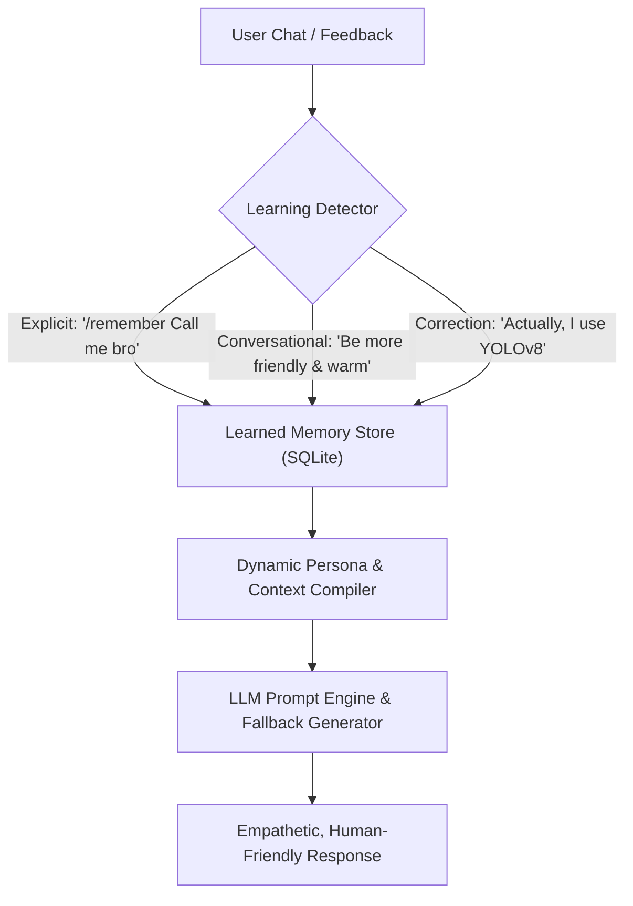
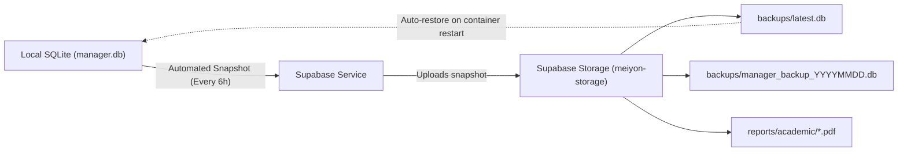

<div align="center">

# 🚀 Meiyon - Executive Personal AI Manager
### Autonomous Career Intelligence, Academic Copilot, Self-Learning Memory & Supabase Cloud Persistence



[](https://python.org)
[](https://fastapi.tiangolo.com)
[](https://supabase.com)
[](https://github.com/Mohilc/meiyonpersonalai)
[](https://github.com/Mohilc/meiyonpersonalai)
[](https://modelcontextprotocol.io)
[](https://build.nvidia.com)
[](https://sqlite.org)
[-10B981?style=for-the-badge&logo=pytest&logoColor=white)](https://pytest.org)
[](https://t.me/Meiyon_ai_bot)
[](https://twilio.com)
[](LICENSE)

*Architected specifically for **Mohil** (B.Tech in Computer Science with Artificial Intelligence at Mar Baselios Christian College of Engineering & Technology, Class of 2027) to manage career planning, job discovery & fraud detection, verified communications, college attendance tracking, self-learning persona adaptation, persistent cloud storage via Supabase, and safe autonomous task execution.*

</div>

---

## 📸 Executive Web Dashboard Interface

The Personal AI Manager features a high-performance Dark Glassmorphism interface connected in real-time to the FastAPI backend, SQLite WAL engine, Supabase Cloud Storage, and local MCP servers.



---

## 📑 Table of Contents
1. [Executive Summary & Core Mission](#1-executive-summary--core-mission)
2. [End-to-End System Architecture](#2-end-to-end-system-architecture)
3. [Deep Dive: How the Agentic Model Works](#3-deep-dive-how-the-agentic-model-works)
   - [A. The Six-Stage Cognitive Loop](#a-the-six-stage-cognitive-loop)
   - [B. Multi-Factor Evidence-Based Fraud Detection Pipeline](#b-multi-factor-evidence-based-fraud-detection-pipeline)
   - [C. Model Context Protocol (MCP 2.x) Execution Bridge](#c-model-context-protocol-mcp-2x-execution-bridge)
   - [D. Autonomy Modes & Human-In-The-Loop (HITL) Security Gates](#d-autonomy-modes--human-in-the-loop-hitl-security-gates)
   - [E. Factual ATS Resume Studio & Zero-Hallucination Invariant](#e-factual-ats-resume-studio--zero-hallucination-invariant)
   - [F. Mathematical Scoring & Priority Models](#f-mathematical-scoring--priority-models)
   - [G. NVIDIA NIM Multi-Model Pool & Nemotron OCR v2](#g-nvidia-nim-multi-model-pool--nemotron-ocr-v2)
4. [Academic Attendance, Absence Logging & PDF Reports](#4-academic-attendance-absence-logging--pdf-reports)
5. [Self-Learning Engine & Adaptive Persona Memory](#5-self-learning-engine--adaptive-persona-memory)
6. [Supabase Cloud Storage & Database Persistence](#6-supabase-cloud-storage--database-persistence)
7. [Mobile Messaging & Dual-Channel Executive AI (Telegram & WhatsApp)](#7-mobile-messaging--dual-channel-executive-ai-telegram--whatsapp)
8. [Cybersecurity & Threat Defense System](#8-cybersecurity--threat-defense-system)
9. [Model Context Protocol (MCP) Server Specifications](#9-model-context-protocol-mcp-server-specifications)
10. [Complete Repository Structure](#10-complete-repository-structure)
11. [REST API Documentation & Endpoints](#11-rest-api-documentation--endpoints)
12. [Setup, Quick Start & Operations](#12-setup-quick-start--operations)

---

## 1. Executive Summary & Core Mission

Early-career engineers and computer science students face severe friction in balancing academic requirements, job discovery, recruiter communications, and schedule prioritization. Concurrently, recruitment scams, check-cashing fraud, phishing attacks, and prompt-injection vulnerabilities pose acute cybersecurity risks.

The **Executive Personal AI Manager** provides a hardened, local-first autonomous agent platform that solves these challenges through:
1. **Ultra-Low Latency Multi-Model Pool**: Powered by NVIDIA NIM with `google/diffusiongemma-26b-a4b-it` delivering sub-second (~0.6s - 1.3s) conversational copilot responses, backed by `nvidia/nemotron-3-super-120b-a12b` for deep strategic reasoning and high-throughput fallback.
2. **Academic Attendance & Absence Tracker**: Real-time logging of classes (`/present <subject>`, `/absent <subject>`), assignment submission tracking, and automated 75% college compliance alerts with instant ReportLab PDF report generation delivered to Telegram and cloud.
3. **Self-Learning & Adaptive Persona Engine**: Dynamic SQLite memory bank (`learned_memories`) that learns user preferences and tone requests in real-time ("Be more friendly", "Call me bro", "Don't use corporate speak"), dynamically shaping both LLM generation and fallback responses.
4. **Supabase Cloud Persistence & Document Storage**: Automated database backups every 6 hours (`backups/latest.db` and timestamped snapshots) to Supabase Storage, preserving state across stateless Render deployments, plus permanent public cloud links for generated PDFs.
5. **24/7 Cloud Keep-Alive System**: Background self-pinger hitting health endpoints every 10 minutes to prevent Render free-tier instances from falling asleep.
6. **Model Context Protocol (MCP 2.x)**: Standardized, secure tool bridging between the AI reasoning engine and external communication channels (Gmail & LinkedIn).
7. **Full-Spectrum LinkedIn MCP Engagement**: Candidate profile inspection, recruiter synchronization, connection requests (<300 chars), feed publishing, **Post Liking (`like_post`)**, **Post Commenting (`comment_on_post`)**, and **AI Comment Ghostwriting**.
8. **Zero-Trust Input Sanitization**: Active adversarial payload stripping and prompt-injection neutralization before text reaches reasoning models or databases.
9. **Evidence-Based Job Scam Detection**: Mathematical scoring against verified ATS domains (`greenhouse.io`, `lever.co`, `workday.com`, `ashbyhq.com`) to flag fraudulent solicitations.
10. **Human-In-The-Loop (HITL) Security Gates**: Strict authorization barriers preventing unauthorized outbound transmissions without explicit human confirmation.
11. **Dual-Channel Mobile Access (Telegram & WhatsApp)**: Full executive co-pilot capability via Telegram (`@Meiyon_ai_bot`) and WhatsApp (Twilio Webhooks & Content Template API).

---

## 2. End-to-End System Architecture



### Key Architectural Specifications:
- **Operating Environment**: Cloud (Render / Railway) + Windows Local Workstation (`Asia/Kolkata` / UTC+05:30).
- **Backend Core**: Python 3.11, FastAPI (asynchronous high-throughput ASGI), Pydantic v2 schemas.
- **Persistence Layer**: SQLite with Write-Ahead Logging (`WAL` mode) + automated Supabase Cloud Snapshots.
- **Protocol Standard**: Model Context Protocol (MCP 2.x) with Stdio transport for IDE pair programming.
- **Cloud Storage**: Supabase Storage (`meiyon-storage`) for backups, documents, and public download links.

---

## 3. Deep Dive: How the Agentic Model Works



### A. The Six-Stage Cognitive Loop
1. **Perception Layer (Continuous Influx)**: Ingests events from Gmail, LinkedIn, Telegram, WhatsApp, and discovered jobs. Uses IMAP `BODY.PEEK[]` to prevent altering the `\Seen` state of the user's real inbox.
2. **Security Firewall & Threat Neutralization**: Strips prompt injections (`ignore previous instructions` &rarr; `[BLOCKED_INJECTION_ATTEMPT]`) and scans for financial scam markers.
3. **Context & Memory Grounding**: Injects verified student profile constraints (Mohil, B.Tech CSE AI '27 at Mar Baselios Christian College) along with real-time learned preferences from SQLite.
4. **Reasoning & Planning (Tree-of-Thought)**: Distinguishes between internal passive analysis and external outbound actions.
5. **Human-In-The-Loop (HITL) Safety Gate**: Stages external actions in the approvals queue; executes only after human authorization.
6. **Execution Layer (MCP Stdio)**: Dispatches approved actions through standard I/O (stdio JSON-RPC) and logs tamper-proof audit trails.

### B. Multi-Factor Evidence-Based Fraud Detection Pipeline
Job postings and recruiter inquiries are evaluated against verified applicant tracking system (ATS) domains (`greenhouse.io`, `lever.co`, `workday.com`, `ashbyhq.com`). Solicitations requesting payment, gift cards, or crypto are immediately flagged as `HIGH_RISK` scams.

---

## 4. Academic Attendance, Absence Logging & PDF Reports

Meiyon actively monitors college attendance and tracks assignments, ensuring you never fall below attendance thresholds.



### Academic Features:
- **Attendance Logging**: Mark presence or absence with a single command (`/present Operating Systems`, `/absent Compiler Design | Sick leave`).
- **75% Threshold Alerts**: Calculates subject-wise and overall attendance percentage, highlighting subjects at risk.
- **Assignment Tracker**: Add assignments with due dates (`/assignment add AI | Mini-Project | 2026-11-15`) and mark them as submitted or graded with marks obtained (`/submit <id> 48`).
- **Executive PDF Report Generator**: Compiles an official executive summary report using ReportLab with custom color palettes, subject breakdown tables, absence histories, and assignment status lists.
- **Supabase Cloud Links**: Automatically uploads generated PDFs to Supabase Storage and delivers both the raw PDF document and a cloud download link directly into Telegram.

---

## 5. Self-Learning Engine & Adaptive Persona Memory

Meiyon continuously learns and evolves based on your natural conversation, instructions, and feedback.



### Self-Learning Features:
- **Zero Latency Adaptation**: Modifies behavior instantly using persistent context augmentation—no expensive model fine-tuning required.
- **Natural Conversational Learning**:
  - *"Please be more friendly and warm"* &rarr; Shifts tone to empathetic, supportive, and conversational.
  - *"Call me Mohil bro"* &rarr; Automatically updates preferred name.
  - *"Remember that my lab drone project uses YOLOv8"* &rarr; Persists technical facts permanently.
- **Explicit Memory Commands**:
  - `/memory` (or `/learned`) — Displays all active learned rules and preferences.
  - `/remember <text>` — Explicitly teaches a rule or habit.
  - `/forget <id or key>` — Soft-deactivates an outdated memory rule.
- **Warm Human-Like Fallbacks**: Even when offline or running without LLM API keys, the fallback engine reads your learned preferences to respond warmly and naturally.

---

## 6. Supabase Cloud Storage & Database Persistence

Designed for stateless cloud hosting (such as Render or Railway free tier), Meiyon uses **Supabase** for zero-loss cloud persistence.



### Cloud Persistence Features:
- **Automated Snapshots**: Performs a thread-safe SQLite `.backup()` every 6 hours and uploads it to Supabase Storage as `backups/latest.db` and timestamped archives.
- **Stateless Cloud Disaster Recovery**: If the Render container restarts or redeploys, Meiyon can restore its complete state from `backups/latest.db`.
- **Public Cloud File Hosting**: Generated attendance PDFs and documents are stored in the public `meiyon-storage` bucket, generating permanent, shareable download links.
- **Telegram & API Controls**:
  - `/supabase` — View connection status and stored cloud objects.
  - `/supabase backup` — Trigger an immediate cloud database snapshot.
  - `/supabase restore` — Pull and restore the latest database snapshot.
  - REST endpoints under `/api/supabase/` (`/status`, `/backup`, `/restore`, `/files`, `/upload`).

---

## 7. Mobile Messaging & Dual-Channel Executive AI (Telegram & WhatsApp)

Meiyon acts as an executive chief-of-staff accessible from anywhere:

### Telegram Bot Commands (`@Meiyon_ai_bot`)

| Command | Action | Description |
| :--- | :--- | :--- |
| `/start` | Welcome Guide | Interactive guide displaying all capabilities and quick commands |
| `/briefing` | Daily Briefing | Top 3 priorities, schedule commitments, and strategic AI advice |
| `/attendance` | Attendance Overview | Current attendance percentages and subject breakdown |
| `/present <sub` | Mark Present | Logs class presence (e.g. `/present Operating Systems`) |
| `/absent <sub` | Mark Absent | Logs absence with notes (e.g. `/absent AI \| Lab setup`) |
| `/assignments` | List Assignments | View pending, submitted, and graded assignments |
| `/assignment add`| Add Assignment | Format: `/assignment add <Sub> \| <Title> \| <Due Date>` |
| `/submit <id> [marks]` | Submit/Grade | Marks assignment submitted or graded (e.g. `/submit a1b2 48`) |
| `/pdf` or `/report` | Academic PDF | Compiles and delivers official Attendance & Assignment PDF |
| `/memory` | Learned Persona | View all active self-learned preferences and persona rules |
| `/remember <text>` | Teach Rule | Explicitly teaches Meiyon a new habit or rule |
| `/forget <id>` | Delete Rule | Erases or deactivates an outdated learned rule |
| `/supabase` | Cloud Storage | Check Supabase connection and view stored cloud files |
| `/supabase backup` | Cloud Snapshot | Trigger instant SQLite database backup to Supabase |
| `/emails` | Live Gmail Inbox | Fetches unread emails with security triage and clean body |
| `/email <1-5>` | Read Email Body | Displays full sanitized email body |
| `/reply <1-5>` | Stage Email Reply | Generates AI draft with Human-in-the-Loop approval gate |
| `/linkedin` | LinkedIn Activity | Checks connection requests and recruiter communications |
| `/tasks` | Task Manager | Lists scheduled commitments and deadlines |
| `/clear` | Reset Buffer | Resets conversation context buffer for a fresh slate |

---

## 8. Cybersecurity & Threat Defense System

- **Adversarial Payload Sanitization**: Strips prompt injection attempts before they reach the reasoning engine.
- **Phishing & Financial Fraud Detection**: Scans recruiter solicitations for advance fee fraud, crypto requests, and suspicious free webmail domains.
- **Tamper-Proof Audit Logging**: Every system action, approval decision, and external transmission is written to an immutable SQLite audit log.
- **Human-In-The-Loop Approval Gates**: Outbound transmissions (sending emails, accepting connections, publishing posts) cannot execute without explicit confirmation.

---

## 9. Model Context Protocol (MCP) Server Specifications

Meiyon implements standard Model Context Protocol (MCP 2.x) servers over Stdio:

- **Gmail MCP Server** ([`mcp_servers/gmail_server.py`](file:///c:/Users/MOHIL/Desktop/agenticai/mcp_servers/gmail_server.py)):
  - `list_unread_emails`: Fetches recent messages using IMAP `BODY.PEEK[]`.
  - `read_email`: Extracts clean plaintext body from multipart HTML/plain emails.
  - `draft_email_reply`: Stages drafted replies in the approval gate.
  - `send_email`: Transmits approved messages via SMTP SSL.
- **LinkedIn MCP Server** ([`mcp_servers/linkedin_server.py`](file:///c:/Users/MOHIL/Desktop/agenticai/mcp_servers/linkedin_server.py)):
  - `get_linkedin_profile`: Reads candidate public headline and summary.
  - `list_connection_requests`: Checks incoming connection invitations.
  - `send_connection_invite`: Sends connection notes strictly validated under 300 characters.
  - `like_post` & `comment_on_post`: Automates post engagement via Playwright with approval gates.

---

## 10. Complete Repository Structure

```
agenticai/
├── .agents/                          # Antigravity IDE Workspace Customizations
│   ├── mcp_config.json               # Registers Gmail & LinkedIn MCP servers
│   └── skills/
│       └── mcp-email-linkedin/
│           └── SKILL.md              # Antigravity tool runbook & safety instructions
├── app/
│   ├── api/                          # REST API Routers
│   │   ├── routes_academic.py        # Attendance, absences, assignments & PDF reports
│   │   ├── routes_approvals.py       # Human authorization gates & audit log
│   │   ├── routes_briefing.py        # Executive daily briefing endpoint
│   │   ├── routes_career.py          # Job discovery, fraud report & resume studio
│   │   ├── routes_communication.py   # Email triage, LinkedIn assistant & MCP sync
│   │   ├── routes_learning.py        # Self-learning engine, memory bank & feedback
│   │   ├── routes_profile.py         # Verified candidate profile & memory
│   │   ├── routes_reminders.py       # Reminder scheduling, triggers & snooze
│   │   ├── routes_supabase.py        # Supabase cloud persistence, backups & files
│   │   ├── routes_system.py          # Point-in-time backups & autonomy mode
│   │   ├── routes_tasks.py           # Task CRUD & commitment verification
│   │   └── routes_webhooks.py        # Telegram & WhatsApp live messaging webhooks
│   ├── models/                       # Pydantic Schemas (v2)
│   │   ├── academic.py               # Attendance, absence & assignment models
│   │   ├── approval.py               # Security gate & audit models
│   │   ├── briefing.py               # Executive summary models
│   │   ├── career.py                 # Job listing & ATS resume models
│   │   ├── communication.py          # Email, LinkedIn & MCP models
│   │   ├── learning.py               # Self-learning memory models & categories
│   │   ├── profile.py                # User profile models
│   │   └── task.py                   # Task & reminder models
│   ├── services/                     # Business Logic & Integrations
│   │   ├── academic_service.py       # Attendance tracking, absences & ReportLab PDF
│   │   ├── audit_service.py          # Security audit trail & gate evaluation
│   │   ├── briefing_service.py       # Priority ranking & executive briefing
│   │   ├── communication_service.py  # Injection sanitizer & recruiter triage
│   │   ├── job_service.py            # Fraud detector & ATS matcher
│   │   ├── learning_service.py       # Dynamic memory bank & tone adaptation
│   │   ├── llm_service.py            # NVIDIA multi-model orchestrator & fallback
│   │   ├── mcp_service.py            # MCP Client orchestrator & sync
│   │   ├── messaging_bot_service.py  # High-speed Telegram & WhatsApp dispatcher
│   │   ├── profile_service.py        # Profile persistence
│   │   ├── prompts.py                # Cognitive prompts & instructions proxy
│   │   ├── reminder_service.py       # Background scheduler & alert delivery
│   │   ├── resume_service.py         # ATS tailoring & application tracking
│   │   ├── supabase_service.py       # Supabase Cloud Storage & database persistence
│   │   └── task_service.py           # Task lifecycle persistence
│   ├── static/                       # Web Dashboard Frontend
│   │   ├── css/style.css             # Dark Glassmorphism design tokens & styles
│   │   ├── js/app.js                 # Single-Page Application logic & live clock
│   │   └── index.html                # Executive Web Dashboard
│   ├── config.py                     # App Settings & environment variables
│   ├── database.py                   # SQLite connection, WAL mode, migrations & seed
│   ├── main.py                       # FastAPI application & scheduler lifecycle
│   └── prompts.py                    # Executive prompts & dynamic memory injection
├── assets/                           # High-Resolution Architectural Graphics
│   ├── meiyon_hero.png               # Ultra-HD Hero Banner
│   ├── architecture_hero.png         # Infographic banner
│   ├── agent_cognition_loop.jpg      # Cognitive architecture workflow
│   └── dashboard_preview.jpg         # Executive dashboard showcase
├── data/                             # SQLite Storage & Reports (git-ignored)
│   ├── manager.db                    # Primary database in WAL mode
│   ├── backups/                      # Snapshot backup archives
│   └── reports/                      # Generated academic PDF reports
├── mcp_servers/                      # Standard Model Context Protocol (MCP) Servers
│   ├── gmail_server.py               # Gmail MCP server (IMAP/SMTP/OAuth/Sandbox)
│   └── linkedin_server.py            # LinkedIn MCP server (Playwright browser/Sandbox)
├── tests/                            # Automated Pytest Suite (63/63 Tests Passing)
│   ├── test_academic.py              # Attendance, absence, assignment & PDF tests
│   ├── test_api.py                   # REST endpoint tests
│   ├── test_approvals.py             # Security gate & audit tests
│   ├── test_briefing.py              # Briefing & priority ranking tests
│   ├── test_career.py                # Job fraud detection & resume tailoring tests
│   ├── test_communication.py         # Prompt injection & scam triage tests
│   ├── test_database.py              # SQLite WAL mode & backup/restore tests
│   ├── test_learning.py              # Self-learning engine, memory & persona tests
│   ├── test_mcp.py                   # Gmail & LinkedIn MCP server & tool tests
│   ├── test_messaging.py             # Telegram & WhatsApp webhook tests
│   ├── test_prompts.py               # Executive prompts & HITL protocol tests
│   ├── test_reminders.py             # Reminder delivery & snooze tests
│   ├── test_supabase.py              # Supabase storage, backup & restore tests
│   └── test_tasks.py                 # Task CRUD & confirmed status tests
├── .env.example                      # Template environment variables
├── MCP_SETUP_GUIDE.md                # Quick visual guide for Gmail & LinkedIn setup
├── run.ps1                           # One-click Windows PowerShell launcher
├── send_whatsapp_chat.py             # WhatsApp template launcher script
└── README.md                         # Project documentation
```

---

## 11. REST API Documentation & Endpoints

| Method | Endpoint | Description | Security Guardrail |
| :--- | :--- | :--- | :--- |
| `GET` | `/api/academic/attendance/summary` | Overall and subject-wise attendance percentages | Read-only |
| `POST` | `/api/academic/attendance/mark` | Logs class attendance (PRESENT / ABSENT) with notes | Ledger Write |
| `GET` | `/api/academic/attendance/absences` | Detailed absence history with notes and timestamps | Read-only |
| `GET` | `/api/academic/assignments` | Lists assignments filtered by status | Read-only |
| `POST` | `/api/academic/assignments` | Adds new course assignment with due date | Ledger Write |
| `PATCH`| `/api/academic/assignments/{id}` | Updates assignment status and records marks | Ledger Write |
| `GET` | `/api/academic/report/pdf` | Generates and streams official ReportLab PDF report | Dynamic Generator |
| `GET` | `/api/learning/memories` | Lists active learned memories and tone preferences | Read-only |
| `POST` | `/api/learning/memories` | Teaches AI a new preference, fact, or style rule | Memory Store |
| `DELETE`| `/api/learning/memories/{id}`| Deactivates an outdated memory rule | Soft Delete |
| `POST` | `/api/learning/feedback` | Submits conversational feedback for instant adaptation | Feedback Loop |
| `GET` | `/api/learning/prompt-context` | Retrieves compiled persona prompt instructions | Prompt Context |
| `GET` | `/api/supabase/status` | Checks Supabase connection, URL, and bucket health | Health Check |
| `POST` | `/api/supabase/backup` | Triggers immediate SQLite cloud backup snapshot | Cloud Snapshot |
| `POST` | `/api/supabase/restore` | Restores local database from cloud snapshot | Cloud Restore |
| `GET` | `/api/supabase/files` | Lists stored objects in Supabase Storage | Read-only |
| `POST` | `/api/supabase/upload` | Direct multipart file upload to Supabase bucket | Storage Write |
| `GET` | `/api/briefing/daily` | Daily top 3 priorities, deadlines & active alerts | Read-only |
| `GET` | `/api/communication/mcp/status`| Checks Gmail and LinkedIn MCP connection status | Read-only |
| `POST` | `/api/communication/mcp/sync-emails` | Syncs unread emails via Gmail MCP with security triage | Safe Ingestion |
| `POST` | `/api/communication/mcp/sync-linkedin`| Syncs recruiter messages and connection invitations | Safe Ingestion |
| `POST` | `/api/communication/emails/{id}/reply`| Stages drafted response in Security Gate | Authorization Required |
| `POST` | `/api/communication/mcp/execute-approved/{id}`| Transmits approved email or post via MCP | **Approval Gate Verified** |
| `GET` | `/api/career/jobs` | Lists discovered opportunities with fraud ratings | Read-only |
| `POST` | `/api/career/tailor-resume` | Contextually tailors master resume against job description | Factual Integrity Check |
| `GET` | `/api/approvals` | Lists actions awaiting explicit user authorization | Security Gate |
| `POST` | `/api/approvals/{id}/decision` | Authorizes or rejects a staged action | User Decision Logged |
| `GET` | `/api/webhooks/status` | Checks live status of Telegram & WhatsApp gateways | Read-only |

---

## 12. Setup, Quick Start & Operations

### A. Environment Configuration (`.env`)

Copy `.env.example` to `.env` and fill in your keys:

```env
# AI Provider (NVIDIA NIM)
AI_PROVIDER="nvidia_nim"
AI_API_KEY="nvapi-xxxxxxxxxxxxxxxxxxxxxxxxxxxxxxxx"
AI_MODEL="google/diffusiongemma-26b-a4b-it"

# Telegram Bot
TELEGRAM_ENABLED="true"
TELEGRAM_BOT_TOKEN="your_bot_token"
TELEGRAM_ALLOWED_CHAT_ID=""

# Supabase Cloud Storage & Database Persistence
SUPABASE_URL="https://your-project.supabase.co"
SUPABASE_KEY="your-supabase-service-role-key"
SUPABASE_STORAGE_BUCKET="meiyon-storage"
SUPABASE_AUTO_SYNC="true"

# Gmail MCP Integration (Optional live sync)
GMAIL_MCP_ENABLED="true"
GMAIL_ADDRESS="your_email@gmail.com"
GMAIL_APP_PASSWORD="xxxx xxxx xxxx xxxx"

# LinkedIn MCP Integration (Optional live sync)
LINKEDIN_MCP_ENABLED="true"
LINKEDIN_LI_AT_COOKIE="your_li_at_cookie"
LINKEDIN_HEADLESS="true"
```

### B. Starting the Application
```powershell
# Using the PowerShell launcher
.\run.ps1

# Or directly with Python
python -m uvicorn app.main:app --host 0.0.0.0 --port 8000 --reload
```
- **Web Dashboard**: [http://localhost:8000](http://localhost:8000)
- **Interactive Swagger Docs**: [http://localhost:8000/docs](http://localhost:8000/docs)

### C. Running the Complete Automated Test Suite (63/63 Tests)

The test suite validates academic tracking, self-learning adaptation, Supabase persistence, prompt injection defenses, fraud scanning, MCP servers, and messaging dispatchers:

```powershell
$env:PYTHONIOENCODING="utf-8"
uv run pytest -v
```

```
============================= test session starts =============================
platform win32 -- Python 3.11.16, pytest-9.1.1, pluggy-1.6.0
rootdir: C:\Users\MOHIL\Desktop\agenticai
plugins: anyio-4.15.1
collected 63 items

tests/test_academic.py .....                                             [  7%]
tests/test_api.py .....                                                  [ 15%]
tests/test_approvals.py .                                                [ 17%]
tests/test_briefing.py .                                                 [ 19%]
tests/test_career.py ...                                                 [ 23%]
tests/test_communication.py .....                                        [ 31%]
tests/test_database.py ...                                               [ 36%]
tests/test_learning.py ......                                            [ 46%]
tests/test_mcp.py .......                                                [ 57%]
tests/test_messaging.py ........                                         [ 69%]
tests/test_prompts.py ..........                                         [ 85%]
tests/test_reminders.py .                                                [ 87%]
tests/test_supabase.py ......                                            [ 96%]
tests/test_tasks.py ..                                                   [100%]

======================== 63 passed in 90.25s (0:01:30) ========================
```

---

<div align="center">
  <sub>Engineered with precision for executive AI management • Built with FastAPI, SQLite WAL, Supabase, Model Context Protocol, Telegram & WhatsApp</sub>
</div>
