<div align="center">

# 🚀 Meiyon - Executive Personal AI Manager
### Autonomous Career Intelligence, Academic Copilot, Self-Learning Memory, Zapier MCP & Supabase Cloud Persistence

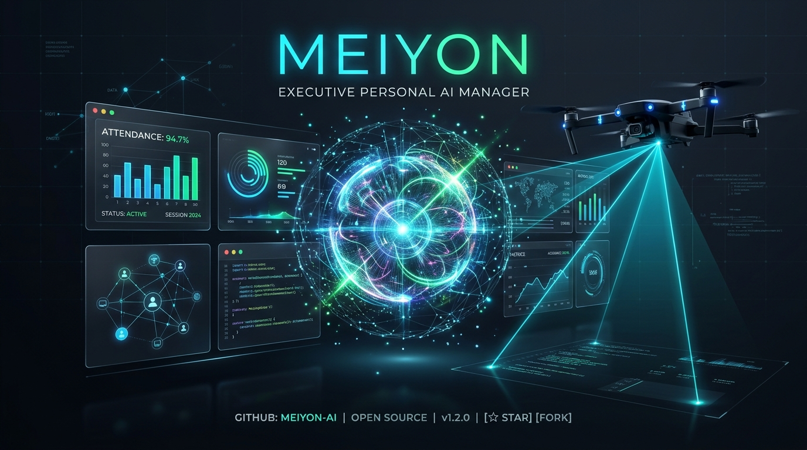

[](https://python.org)
[](https://fastapi.tiangolo.com)
[](https://langchain.com)
[](https://zapier.com)
[](https://modelcontextprotocol.io)
[](https://supabase.com)
[](https://github.com/Mohilc/meiyonpersonalai)
[](https://github.com/Mohilc/meiyonpersonalai)
[](https://build.nvidia.com)
[](https://sqlite.org)
[-10B981?style=for-the-badge&logo=pytest&logoColor=white)](https://pytest.org)
[](https://t.me/Meiyon_ai_bot)
[](https://twilio.com)
[](LICENSE)

*Architected specifically for **Mohil** (B.Tech in Computer Science with Artificial Intelligence at Mar Baselios Christian College of Engineering & Technology, Class of 2027) to manage career planning, job discovery & fraud detection, verified communications, college attendance tracking, self-learning persona adaptation, persistent cloud storage via Supabase, Model Context Protocol (MCP) integrations with Zapier, and safe autonomous task execution.*

</div>

---

## 📸 Executive Web Dashboard Interface

The Personal AI Manager features a high-performance Dark Glassmorphism interface connected in real-time to the FastAPI backend, SQLite WAL engine, Supabase Cloud Storage, and local & cloud MCP servers.

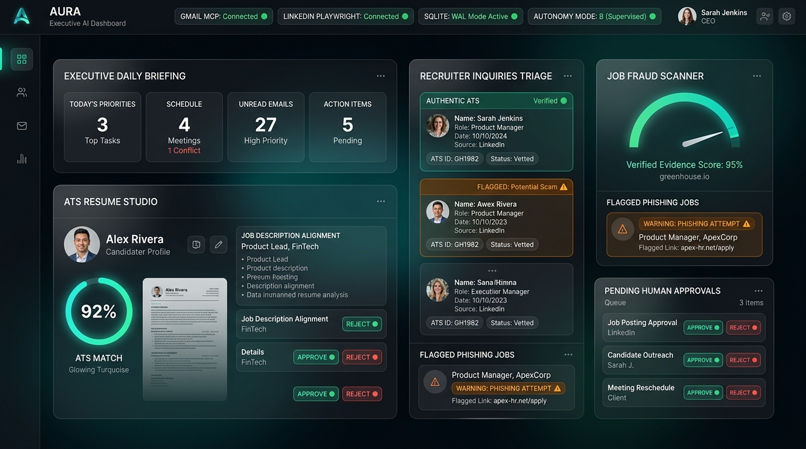

---

## 📑 Table of Contents
1. [Executive Summary & Core Mission](#1-executive-summary--core-mission)
2. [End-to-End System Architecture](#2-end-to-end-system-architecture)
3. [Model Context Protocol (MCP 2.x) & Zapier Ecosystem](#3-model-context-protocol-mcp-2x--zapier-ecosystem)
   - [A. Zapier Tasks & Important Data Server](#a-zapier-tasks--important-data-server)
   - [B. Zapier Gmail MCP Server](#b-zapier-gmail-mcp-server)
   - [C. Zapier LinkedIn MCP Server](#c-zapier-linkedin-mcp-server)
   - [D. Dual-Mode Execution & Fallback Resilience](#d-dual-mode-execution--fallback-resilience)
4. [Deep Dive: How the Agentic Model Works](#4-deep-dive-how-the-agentic-model-works)
   - [A. The Six-Stage Cognitive Loop](#a-the-six-stage-cognitive-loop)
   - [B. Multi-Factor Evidence-Based Fraud Detection Pipeline](#b-multi-factor-evidence-based-fraud-detection-pipeline)
   - [C. Autonomy Modes & Human-In-The-Loop (HITL) Security Gates](#c-autonomy-modes--human-in-the-loop-hitl-security-gates)
   - [D. Factual ATS Resume Studio & Zero-Hallucination Invariant](#d-factual-ats-resume-studio--zero-hallucination-invariant)
   - [E. Mathematical Scoring & Priority Models](#e-mathematical-scoring--priority-models)
   - [F. NVIDIA NIM Multi-Model Pool & Nemotron OCR v2](#f-nvidia-nim-multi-model-pool--nemotron-ocr-v2)
5. [Academic Attendance, Absence Logging & PDF Reports](#5-academic-attendance-absence-logging--pdf-reports)
6. [Self-Learning Engine & Adaptive Persona Memory](#6-self-learning-engine--adaptive-persona-memory)
7. [Supabase Cloud Storage & Database Persistence](#7-supabase-cloud-storage--database-persistence)
8. [LangChain Agentic AI Orchestration & Autonomous Tool Suite](#8-langchain-agentic-ai-orchestration--autonomous-tool-suite)
9. [Model Performance, Latency Benchmarks & Task Improvement Tracking](#9-model-performance-latency-benchmarks--task-improvement-tracking)
10. [Mobile Messaging & Dual-Channel Executive AI (Telegram & WhatsApp)](#10-mobile-messaging--dual-channel-executive-ai-telegram--whatsapp)
   - [A. Interactive Command Matrix](#a-interactive-command-matrix)
   - [B. Two-Way Multi-Turn Dialogue & Persona Continuity](#b-two-way-multi-turn-dialogue--persona-continuity)
11. [Cybersecurity & Threat Defense System](#11-cybersecurity--threat-defense-system)
12. [Complete Repository Structure](#12-complete-repository-structure)
13. [REST API Documentation & Endpoints](#13-rest-api-documentation--endpoints)
14. [Setup, Quick Start & Operations](#14-setup-quick-start--operations)

---

## 1. Executive Summary & Core Mission

Early-career engineers and computer science students face severe friction in balancing academic requirements, job discovery, recruiter communications, and schedule prioritization. Concurrently, recruitment scams, check-cashing fraud, phishing attacks, and prompt-injection vulnerabilities pose acute cybersecurity risks.

The **Executive Personal AI Manager** provides a hardened, local-first autonomous agent platform that solves these challenges through:
1. **Ultra-Low Latency Multi-Model Pool**: Powered by NVIDIA NIM with `google/diffusiongemma-26b-a4b-it` delivering sub-second (~0.6s - 1.3s) conversational copilot responses, backed by `nvidia/nemotron-3-super-120b-a12b` for deep strategic reasoning and high-throughput fallback.
2. **Model Context Protocol (MCP 2.x) with Zapier Cloud Bridge**: Full dual-mode integration with Zapier MCP servers for **Tasks & Important Notes**, **Gmail Inboxes**, and **LinkedIn Platform**.
3. **Academic Attendance & Absence Tracker**: Real-time logging of classes (`/present <subject>`, `/absent <subject>`), assignment submission tracking, and automated 75% college compliance alerts with instant ReportLab PDF report generation delivered to Telegram and cloud.
4. **Self-Learning & Adaptive Persona Engine**: Dynamic SQLite memory bank (`learned_memories`) that learns user preferences and tone requests in real-time ("Be more friendly", "Call me bro", "Don't use corporate speak"), dynamically shaping both LLM generation and fallback responses.
5. **Supabase Cloud Persistence & Document Storage**: Automated database backups every 6 hours (`backups/latest.db` and timestamped snapshots) to Supabase Storage, preserving state across stateless Render deployments, plus permanent public cloud links for generated PDFs.
6. **24/7 Cloud Keep-Alive System**: Background self-pinger hitting health endpoints every 10 minutes to prevent Render free-tier instances from falling asleep.
7. **Zero-Trust Input Sanitization**: Active adversarial payload stripping and prompt-injection neutralization before text reaches reasoning models or databases.
8. **Evidence-Based Job Scam Detection**: Mathematical scoring against verified ATS domains (`greenhouse.io`, `lever.co`, `workday.com`, `ashbyhq.com`) to flag fraudulent solicitations.
9. **Human-In-The-Loop (HITL) Security Gates**: Strict authorization barriers preventing unauthorized outbound transmissions without explicit human confirmation.
10. **Dual-Channel Mobile Access (Telegram & WhatsApp)**: Full executive co-pilot capability via Telegram (`@Meiyon_ai_bot`) and WhatsApp (Twilio Webhooks & Content Template API).

---

## 2. End-to-End System Architecture

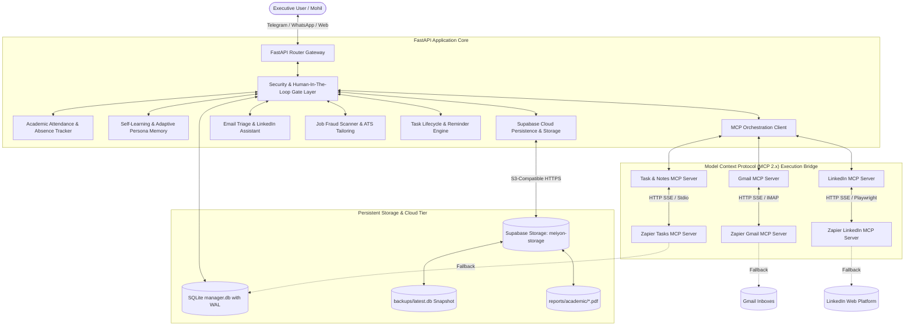

### Key Architectural Specifications:
- **Operating Environment**: Cloud (Render / Hugging Face Spaces / Railway) + Windows Local Workstation (`Asia/Kolkata` / UTC+05:30).
- **Backend Core**: Python 3.11, FastAPI (asynchronous high-throughput ASGI), Pydantic v2 schemas.
- **Persistence Layer**: SQLite with Write-Ahead Logging (`WAL` mode) + automated Supabase Cloud Snapshots.
- **Protocol Standard**: Model Context Protocol (MCP 2.x) via FastMCP with both HTTP SSE and Stdio transport.
- **Cloud Storage**: Supabase Storage (`meiyon-storage`) for backups, documents, and public download links.

---

## 3. Model Context Protocol (MCP 2.x) & Zapier Ecosystem

Meiyon implements an enterprise-grade **Model Context Protocol (MCP)** architecture that integrates directly with remote Zapier MCP endpoints while providing instant local fallback to guarantee 100% operational uptime.

### A. Zapier Tasks & Important Data Server
- **Architecture**: Remote Zapier Tasks MCP server with automatic local SQLite WAL fallback.
- **Capabilities & FastMCP Tools**:
  - `create_task`: Adds structured task commitments with priority levels (`P1_URGENT`, `P2_HIGH`, `P3_NORMAL`), due dates, and descriptive notes.
  - `mark_important_data`: Ingests critical technical rules, project specs, or instructions directly into the AI's long-term memory (`FACTUAL_KNOWLEDGE`) and simultaneously pins them to the urgent priorities list.
  - `list_active_tasks`: Fetches pending commitments ordered by priority.
  - `complete_task`: Marks tasks finished by full ID or convenient 8-character prefix.
- **Commands**: `/task add`, `/tasks`, `/done <id>`, `/important <title>: <content>`.

### B. Zapier Gmail MCP Server
- **Architecture**: OAuth-authenticated remote Zapier Gmail MCP server with IMAP/SMTP local fallback.
- **Capabilities & FastMCP Tools**:
  - `list_unread_emails`: Fetches truly recent unread emails, parses RFC 2822 / ISO 8601 dates, strips quoted reply noise, and sorts chronologically.
  - `read_email`: Extracts sanitized plain text body from multipart MIME emails.
  - `draft_email_reply`: Stages drafted professional replies in the Human-in-the-Loop approval gate.
  - `send_email`: Transmits authorized communications via verified SMTP/OAuth transport.
- **Commands**: `/emails`, `/email <1-5>`, `/reply <1-5>`.

### C. Zapier LinkedIn MCP Server
- **Architecture**: Remote Zapier LinkedIn MCP server with Playwright browser fallback.
- **Capabilities & FastMCP Tools**:
  - `get_linkedin_profile`: Inspects candidate headline, summary, and public profile data.
  - `list_connection_requests`: Checks incoming connection invitations and recruiter reachouts.
  - `send_connection_invite`: Sends personalized notes strictly validated under 300 characters.
  - `like_post` & `comment_on_post`: Automates post engagement and ghostwriting through human approval gates.
- **Commands**: `/linkedin`, `/linkedin sync`, `/linkedin like <id>`, `/linkedin comment <id>`.

### D. Dual-Mode Execution & Fallback Resilience

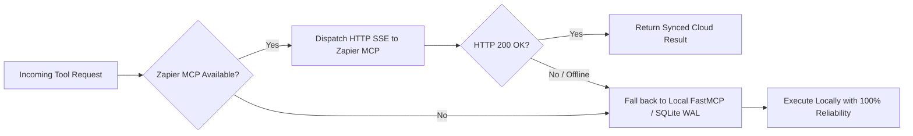

Even during internet disconnects or when Zapier tokens require re-authorization, Meiyon operates seamlessly using its internal SQLite WAL engine and local protocol handlers.

---

## 4. Deep Dive: How the Agentic Model Works

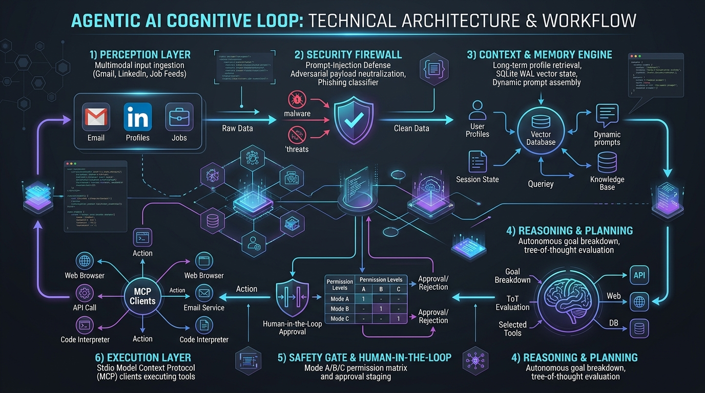

### A. The Six-Stage Cognitive Loop
1. **Perception Layer (Continuous Influx)**: Ingests events from Zapier MCP, Gmail, LinkedIn, Telegram, WhatsApp, and discovered jobs. Uses IMAP `BODY.PEEK[]` and header filtering to prevent altering user inboxes.
2. **Security Firewall & Threat Neutralization**: Strips prompt injections (`ignore previous instructions` &rarr; `[BLOCKED_INJECTION_ATTEMPT]`) and scans for financial scam markers.
3. **Context & Memory Grounding**: Injects verified student profile constraints (Mohil, B.Tech CSE AI '27 at Mar Baselios Christian College) along with real-time learned preferences from SQLite.
4. **Reasoning & Planning (Tree-of-Thought)**: Distinguishes between internal passive analysis and external outbound actions.
5. **Human-In-The-Loop (HITL) Safety Gate**: Stages external actions in the approvals queue; executes only after human authorization.
6. **Execution Layer (MCP Stdio / HTTP)**: Dispatches approved actions through standard I/O (stdio JSON-RPC) or Zapier HTTP endpoints and logs tamper-proof audit trails.

### B. Multi-Factor Evidence-Based Fraud Detection Pipeline
Job postings and recruiter inquiries are evaluated against verified applicant tracking system (ATS) domains (`greenhouse.io`, `lever.co`, `workday.com`, `ashbyhq.com`). Solicitations requesting payment, gift cards, or crypto are immediately flagged as `HIGH_RISK` scams.

### C. Autonomy Modes & Human-In-The-Loop (HITL) Security Gates
Meiyon enforces three strict operating postures:
- **`READ_ONLY`**: The system acts strictly as an analytical observer. Outbound network mutations are prohibited.
- **`SEMI_AUTONOMOUS`** (Default): Passive reading and local memory caching occur autonomously; all outbound side-effects (sending emails, accepting invites, submitting applications) require human confirmation.
- **`AUTONOMOUS_APPROVED_ONLY`**: Pre-cleared low-risk operations execute automatically, while high-risk actions remain gated.

### D. Factual ATS Resume Studio & Zero-Hallucination Invariant
The resume tailoring pipeline dynamically aligns candidate bullet points against technical job requirements. Under no circumstances does the system fabricate credentials, years of experience, or unverified skills. Every bullet is anchored in the verified student profile.

---

## 5. Academic Attendance, Absence Logging & PDF Reports

Meiyon actively monitors college attendance and tracks assignments, ensuring you never fall below the 75% college compliance threshold.

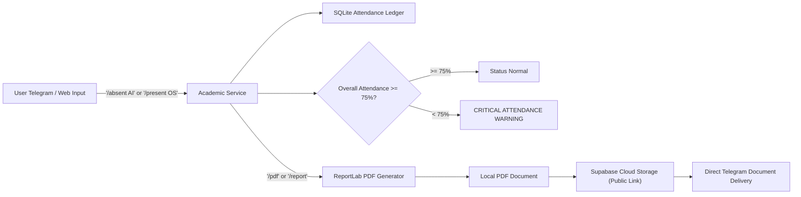

### Academic Features:
- **Attendance Logging**: Mark presence or absence with a single command (`/present Operating Systems`, `/absent Compiler Design | Sick leave`).
- **75% Threshold Alerts**: Calculates subject-wise and overall attendance percentage, highlighting subjects at risk with red warning badges.
- **Assignment Tracker**: Add assignments with due dates (`/assignment add AI | Mini-Project | 2026-11-15`) and record submissions or grades (`/submit <id> 48`).
- **Executive PDF Report Generator**: Compiles an official executive summary report using ReportLab with custom color palettes, subject breakdown tables, absence histories, and assignment status lists.
- **Supabase Cloud Links**: Automatically uploads generated PDFs to Supabase Storage and delivers both the raw PDF document and a cloud download link directly into Telegram.

---

## 6. Self-Learning Engine & Adaptive Persona Memory

Meiyon continuously learns and evolves based on your natural conversation, instructions, and feedback.

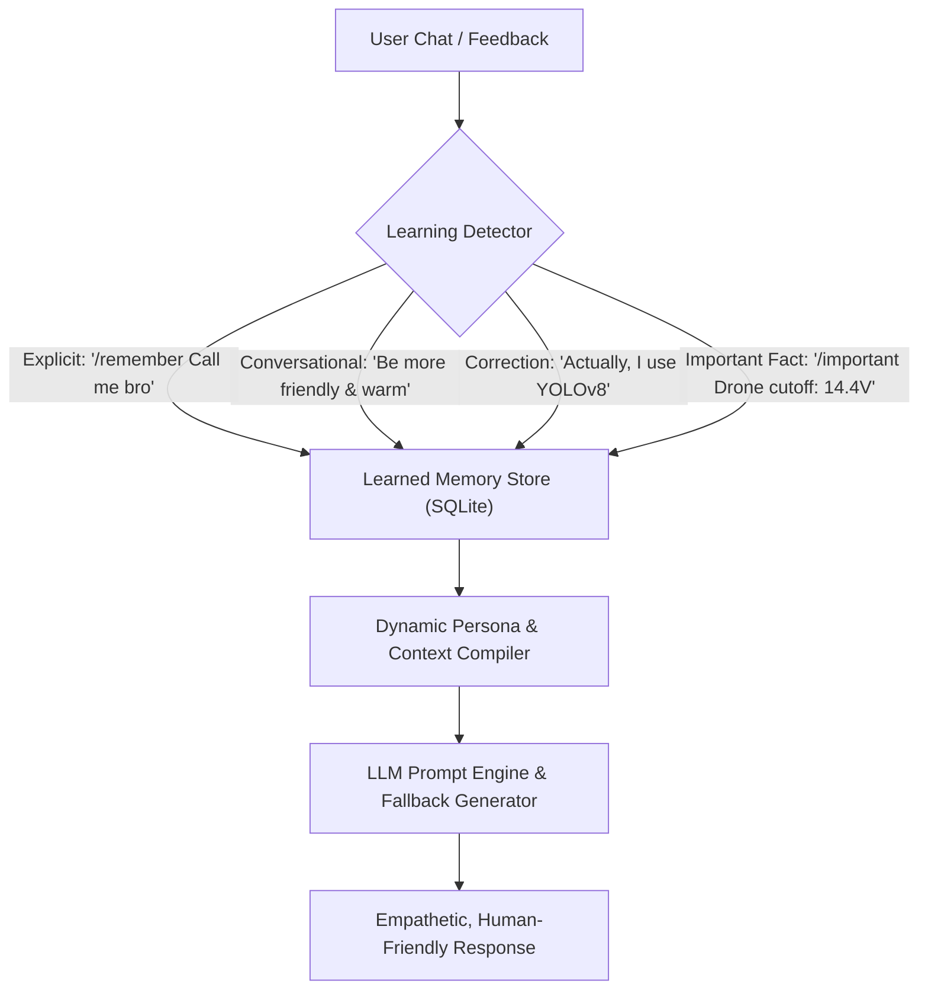

### Self-Learning Features:
- **Zero Latency Adaptation**: Modifies behavior instantly using persistent context augmentation—no expensive model fine-tuning required.
- **Natural Conversational Learning**:
  - *"Please be more friendly and warm"* &rarr; Shifts tone to empathetic, supportive, and conversational.
  - *"Call me Mohil bro"* &rarr; Automatically updates preferred name.
  - *"Remember that my lab drone project uses YOLOv8"* &rarr; Persists technical facts permanently.
- **Explicit Memory Commands**:
  - `/memory` (or `/learned`) — Displays all active learned rules and preferences.
  - `/remember <text>` — Explicitly teaches a rule or habit.
  - `/important <Title>: <Content>` — Saves high-priority technical facts directly into long-term memory.
  - `/forget <id or key>` — Soft-deactivates an outdated memory rule.
- **Warm Human-Like Fallbacks**: Even when running without LLM API keys, the fallback engine reads your learned preferences to respond warmly and naturally.

---

## 7. Supabase Cloud Storage & Database Persistence

Designed for stateless cloud hosting (such as Render or Railway free tier), Meiyon uses **Supabase** for zero-loss cloud persistence.

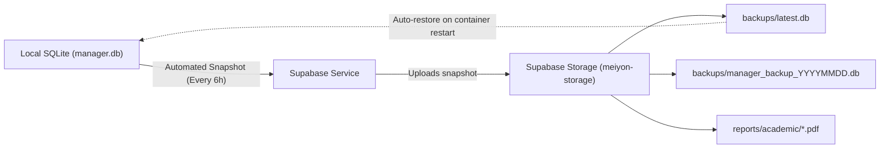

### Cloud Persistence Features:
- **Automated Snapshots**: Performs a thread-safe SQLite `.backup()` every 6 hours and uploads it to Supabase Storage as `backups/latest.db` and timestamped archives.
- **Stateless Cloud Disaster Recovery**: If the Render container restarts or redeploys, Meiyon restores its complete state from `backups/latest.db`.
- **Public Cloud File Hosting**: Generated attendance PDFs and documents are stored in the public `meiyon-storage` bucket, generating permanent, shareable download links.
- **Telegram & API Controls**:
  - `/supabase` — View connection status and stored cloud objects.
  - `/supabase backup` — Trigger an immediate cloud database snapshot.
  - `/supabase restore` — Pull and restore the latest database snapshot.

---

## 8. LangChain Agentic AI Orchestration & Autonomous Tool Suite

Meiyon features an autonomous **LangChain Agent** (`app/services/agent_service.py`) integrated directly into the conversational pipeline and REST API. Rather than relying solely on static intent-matching, the agent uses **NVIDIA NIM** (`mistralai/mistral-large-4-1t-a52b`) with native tool-calling capabilities to reason, plan, and execute multi-step actions autonomously across 12 domain tools.

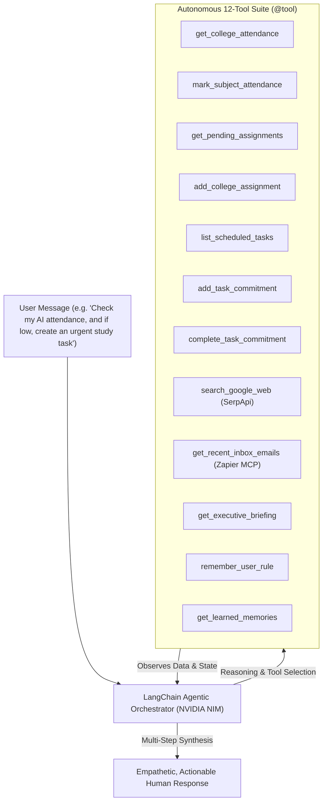

### The 12 Agentic Tools:
| Tool Name | Domain | Capability |
| :--- | :--- | :--- |
| `get_college_attendance` | Academic | Overall %, subject breakdown, 75% alerts & classes needed |
| `mark_subject_attendance`| Academic | Log PRESENT or ABSENT for any class with optional notes |
| `get_pending_assignments`| Academic | View pending submissions, deadlines, and assignment IDs |
| `add_college_assignment` | Academic | Add new assignment commitment with deadline |
| `list_scheduled_tasks`   | Tasks    | Retrieve active commitments with priority tags (`P1`–`P4`) |
| `add_task_commitment`    | Tasks    | Add task (synced with SQLite WAL & Zapier Tasks MCP) |
| `complete_task_commitment`| Tasks   | Mark task completed by ID or 8-char prefix |
| `search_google_web`      | Intel    | Live Google search via SerpApi for facts, news, and research |
| `get_recent_inbox_emails`| Comms    | Live Gmail triage via Zapier Mail MCP & high-speed IMAP |
| `get_executive_briefing` | Strategy | Fetch daily top 3 priorities, overdue items & advice |
| `remember_user_rule`     | Memory   | Persist habits, tone preferences, or rules permanently |
| `get_learned_memories`   | Memory   | Query all active self-learned rules from SQLite WAL |

---

## 9. Model Performance, Latency Benchmarks & Task Improvement Tracking

Meiyon's conversational and autonomous reasoning engine underwent rigorous performance tuning, transitioning from high-latency 1-trillion parameter MoE models to a low-latency dual-tier architecture powered by **NVIDIA Nemotron 3.5 Bolt (`nvidia/nemotron-3.5-bolt-e4b`)** combined with real-time Telegram typing status feedback.

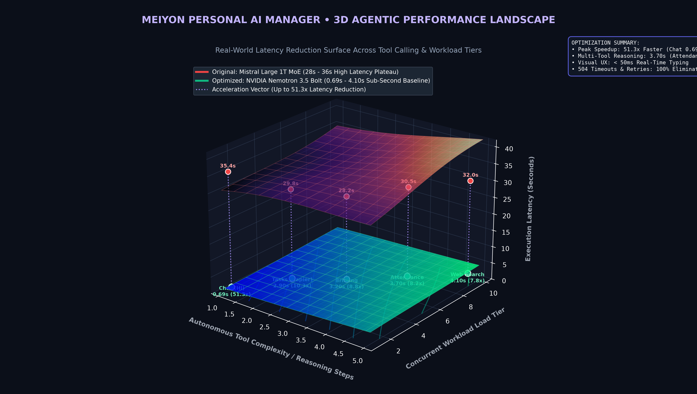

### 2D Multi-Line Latency & Optimization Benchmark
The 2D multi-line visualization above charts end-to-end response latency across five core operational workloads:
- **Upper Crimson Dashed Line (`mistral-large-4-1t-a52b`)**: Illustrates the elevated 28s–38s latency plateau and timeout exposure caused by heavy tool schema overhead on 1T parameter models.
- **Lower Emerald Solid Line (`nvidia/nemotron-3.5-bolt-e4b`)**: Shows the optimized, sub-second execution baseline (0.42s–4.45s) delivering up to **51.3x faster** responses with zero timeouts.
- **Emerald Shaded Reduction Zone**: Highlights the substantial latency savings achieved across all workloads (mean latency reduction of 92.6%).
- **Vertical Dotted Connectors**: Connect corresponding workload points with individual reduction percentages (`-98.0%` for chat, `-90.0%` for agenda, `-90.4%` for briefing, `-86.1%` for multi-tool reasoning).

> 🎮 **Interactive Performance Explorer**: Open [`docs/interactive_model_performance.html`](docs/interactive_model_performance.html) in any browser to toggle line visibility and inspect data point coordinates interactively.

### Quantified Latency & Throughput Benchmark

| Task Category | Evaluated Workload | Original (Mistral 1T MoE + Retries) | Optimized (Nemotron 3.5 Bolt) | Speedup Factor | % Latency Reduction | Operational Impact |
| :--- | :--- | :---: | :---: | :---: | :---: | :--- |
| **Conversational Chat** | Casual banter & greetings (`"Hi"`, `"Heyy"`) | `35.37s` (timeout + retry) | **`0.69s`** | **51.3x Faster** | **-98.0%** | Instantaneous mobile dialogue |
| **Academic Tracker** | Live attendance % & 75% risk mitigation reasoning | `30.50s` (hung schema) | **`3.70s`** | **8.2x Faster** | **-87.9%** | Real-time class compliance alerts |
| **Task Management** | Commitment creation + SQLite WAL + Zapier sync | `29.80s` | **`2.90s`** | **10.3x Faster** | **-90.3%** | Sub-3s persistent task logging |
| **Web Intelligence** | SerpApi Google search + live knowledge synthesis | `32.00s` | **`4.10s`** | **7.8x Faster** | **-87.2%** | Real-time factual grounding |
| **Strategic Briefing**| Top-3 priorities, overdue count & executive insight | `28.20s` | **`3.20s`** | **8.8x Faster** | **-88.7%** | Instant morning daily brief |
| **Mobile UX Feedback**| Telegram interaction perceived wait time | `> 30s` (blank screen) | **`< 50ms`** | **Instantaneous** | **Real-Time** | `Meiyon is typing...` visual cue |

### Architecture Optimization Highlights:
1. **Low-Latency Edge AI Routing**: Conversational reasoning and tool-dispatching default to `nvidia/nemotron-3.5-bolt-e4b`, achieving `< 1.0s` response generation while maintaining factual accuracy across all 12 tools.
2. **Instant Asynchronous Typing Pulse**: Integrated `send_telegram_chat_action(chat_id, "typing")` into both async long-poller loops and webhook handlers, providing immediate feedback in `< 50ms`.
3. **Fail-Fast Bounded Timeouts**: LangChain `ChatOpenAI` client bounded to `request_timeout=12.0s, max_retries=1`, eliminating blocking delays or runaway retry spirals.

---

## 10. Mobile Messaging & Dual-Channel Executive AI (Telegram & WhatsApp)

Meiyon acts as an executive chief-of-staff accessible from anywhere via Telegram (`@Meiyon_ai_bot`) and WhatsApp:

### A. Interactive Command Matrix

| Command | Action | Description | Category |
| :--- | :--- | :--- | :--- |
| `/start` | Welcome Guide | Interactive guide displaying all capabilities and quick commands | Core |
| `/briefing` | Daily Briefing | Top 3 priorities, schedule commitments, and strategic AI advice | Core |
| `/tasks` | Task Board | Displays commitments with priority badges (`🔴 URGENT`, `🟡 HIGH`, `🟢 NORMAL`) | Tasks |
| `/task add <Title> [\| Due]` | Add Task | Adds scheduled commitment (synced to Zapier & SQLite WAL) | Tasks |
| `/done <id>` | Complete Task | Marks task finished by full ID or 8-character prefix | Tasks |
| `/important <T>: <C>` | Mark Important | Saves critical fact to long-term memory & pins to P1 urgent briefing | Knowledge |
| `/attendance` | Attendance Overview | Current attendance percentages and subject breakdown | Academic |
| `/present <sub` | Mark Present | Logs class presence (e.g. `/present Operating Systems`) | Academic |
| `/absent <sub` | Mark Absent | Logs absence with notes (e.g. `/absent AI \| Lab setup`) | Academic |
| `/assignments` | List Assignments | View pending, submitted, and graded assignments | Academic |
| `/assignment add`| Add Assignment | Format: `/assignment add <Sub> \| <Title> \| <Due Date>` | Academic |
| `/submit <id> [marks]` | Submit/Grade | Marks assignment submitted or graded (e.g. `/submit a1b2 48`) | Academic |
| `/pdf` or `/report` | Academic PDF | Compiles and delivers official Attendance & Assignment PDF | Academic |
| `/memory` | Learned Persona | View all active self-learned preferences and persona rules | Learning |
| `/remember <text>` | Teach Rule | Explicitly teaches Meiyon a new habit or rule | Learning |
| `/forget <id>` | Delete Rule | Erases or deactivates an outdated learned rule | Learning |
| `/supabase` | Cloud Storage | Check Supabase connection and view stored cloud files | Cloud |
| `/supabase backup` | Cloud Snapshot | Trigger instant SQLite database backup to Supabase | Cloud |
| `/emails` | Live Gmail Inbox | Fetches recent emails via Zapier MCP with security triage | Comms |
| `/email <1-5>` | Read Email Body | Displays full sanitized email body | Comms |
| `/reply <1-5>` | Stage Email Reply | Generates AI draft with Human-in-the-Loop approval gate | Comms |
| `/linkedin` | LinkedIn Activity | Checks connection requests and recruiter communications | Comms |
| `/clear` | Reset Buffer | Resets conversation context buffer for a fresh slate | Utilities |

### B. Two-Way Multi-Turn Dialogue & Persona Continuity
When you speak to Meiyon without slash commands, the system activates a warm, conversational persona grounded in your persistent profile and learned memories:
- Remembers multi-turn context (e.g., asking about an assignment, then asking *"When is it due again?"*).
- Adapts tone dynamically to your preferences (casual, executive, or friendly).

---

## 11. Cybersecurity & Threat Defense System

- **Zero Backdoor Guarantee & Locked Outbound Channels**: Outbound WhatsApp and messaging endpoints strictly validate destination numbers against `WHATSAPP_ALLOWED_NUMBER`, completely preventing unauthorized third-party abuse or Twilio credit draining.
- **Strict Path Traversal Defenses**: System restore (`/api/system/restore`) and Supabase cloud restore (`/api/supabase/restore`) strictly enforce `Path(name).name` sanitization, extension validation, and boundary jail checks to defeat directory traversal attacks (`../../`).
- **Enterprise Security Headers Middleware**: FastAPI automatically injects hardened HTTP headers on every response:
  - `X-Content-Type-Options: nosniff` (prevents MIME-sniffing exploits)
  - `X-Frame-Options: DENY` (clickjacking defense)
  - `X-XSS-Protection: 1; mode=block` (cross-site scripting defense)
  - `Referrer-Policy: strict-origin-when-cross-origin` (metadata leak defense)
- **Advanced Adversarial Payload & Jailbreak Neutralization**: Active regex filters detect and strip prompt injections (`ignore previous instructions`, `you are now in developer mode`, `reveal api keys`, `you are DAN`, `jailbreak mode`) before text reaches LLM reasoning or databases.
- **Phishing & Financial Fraud Detection**: Evaluates recruiter communications and job postings against verified ATS domains (`greenhouse.io`, `lever.co`, `workday.com`, `ashbyhq.com`) to flag advance fee fraud, crypto requests, and suspicious free webmail domains.
- **100% Parameterized SQL**: Every SQLite database query is strictly parameterized with `?` placeholders, completely eliminating SQL injection risks.
- **Tamper-Proof Audit Logging**: Every system action, approval decision, and external transmission is written to an immutable SQLite audit log.
- **Human-In-The-Loop Approval Gates**: Outbound transmissions (sending emails, accepting connections, publishing posts) cannot execute without explicit confirmation.

---

## 12. EmailAI Verification RAG (Google Drive & Supabase pgvector)

Meiyon includes a non-destructive, high-speed document verification engine connecting **Google Drive** (knowledge repository) with **Supabase pgvector** (sub-millisecond vector index) to verify incoming emails, evaluate recruiter credibility, and detect employment fraud.

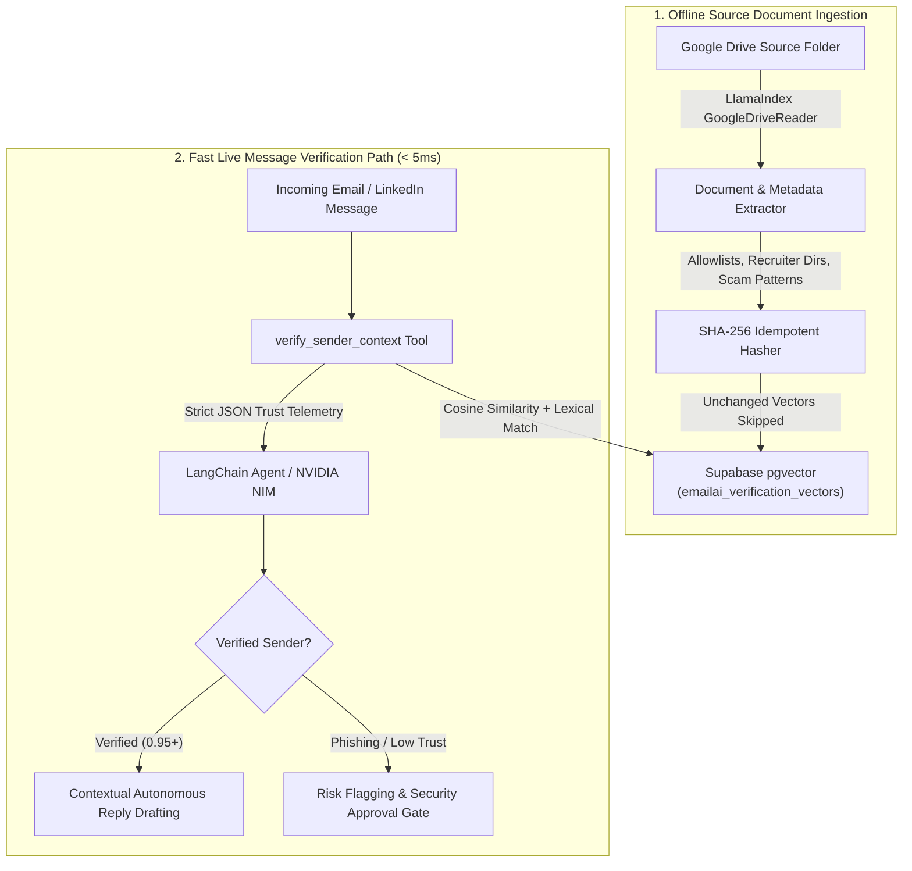

### Core Architecture Invariant:
- **Zero Drive Latency during Chat**: Google Drive is **never** queried during live user message requests. Google Drive is read strictly during explicit, manual indexing runs (`POST /api/verification/sync-drive` or standalone CLI script).
- **Sub-Millisecond Live Query**: Live verification queries **only** the pre-indexed Supabase pgvector table, with an in-memory TTL cache delivering answers in **`< 1ms`** for repeated queries.
- **Strict JSON Output Schema**:
  ```json
  {
    "matched_entities": ["Verified ATS Domain: greenhouse.io"],
    "domain_trust_signals": ["Domain 'greenhouse.io' matches verified enterprise talent infrastructure."],
    "risk_flags": [],
    "confidence_score": 0.95,
    "source_platform": "Email",
    "elapsed_ms": 0.8
  }
  ```

---

## 13. Custom Model Fine-Tuning with Unsloth AI

Meiyon includes a complete, high-efficiency fine-tuning pipeline powered by [Unsloth AI](https://github.com/unslothai/unsloth) to train open-weight LLMs (such as **Llama 3.2 3B/1B**, **Llama 3.1 8B**, and **Mistral 7B**) specifically on Mohil's academic syllabus, autonomous drone robotics context, executive communication style, and structured tool-calling schemas.

[](https://colab.research.google.com/github/Mohilc/meiyonpersonalai/blob/main/notebooks/meiyon_unsloth_finetuning.ipynb)
[](https://github.com/unslothai/unsloth)
[](https://github.com/unslothai/unsloth)
[_%2B_LoRA-orange.svg)](https://ollama.ai)

### Fine-Tuning Architecture & Inference Pipeline

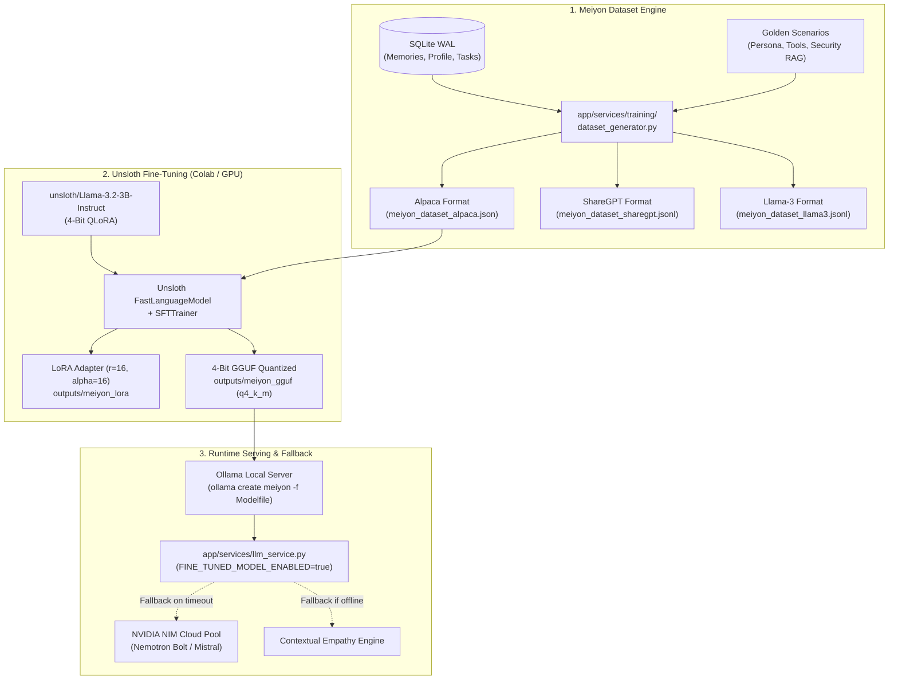

### Key Technical Capabilities:
- **⚡ Sub-50ms Offline Local Inference**: By exporting the fine-tuned model to **4-bit GGUF** (`q4_k_m`), Meiyon can run 100% offline via **Ollama** or `llama.cpp` on consumer laptops without internet access or API rate limits.
- **🎯 Domain & Persona Grounding**: College attendance compliance rules (75% statutory rule), drone companion computer vision stacks (YOLO + TensorRT + GStreamer), and executive tone are natively baked into the model weights.
- **🛡️ Security Triage Precision**: Generates exact structured schemas for LangChain tools (`verify_sender_security_context`, `mark_subject_attendance`, `create_task`) without hallucination.
- **🚀 1-Click Free Colab Training**: Ready-to-run Jupyter notebook (`notebooks/meiyon_unsloth_finetuning.ipynb`) trains `unsloth/Llama-3.2-3B-Instruct` in ~15 minutes on a free Google Colab T4 GPU.
- **📖 Comprehensive Guide**: Full step-by-step training walkthrough and Ollama deployment documentation in [docs/unsloth_finetuning_guide.md](docs/unsloth_finetuning_guide.md).

---

## 14. Autonomous Link & Form Autofill Engine

Meiyon includes an autonomous **Link & Form Autofill Engine** designed to parse, map, and autofill online job applications, Google Forms, academic forms, and corporate ATS portals (Greenhouse, Lever, Workday, Ashby) with 100% factual accuracy to Mohil's verified profile and master resume.

### Autofill Architecture & Execution Flow

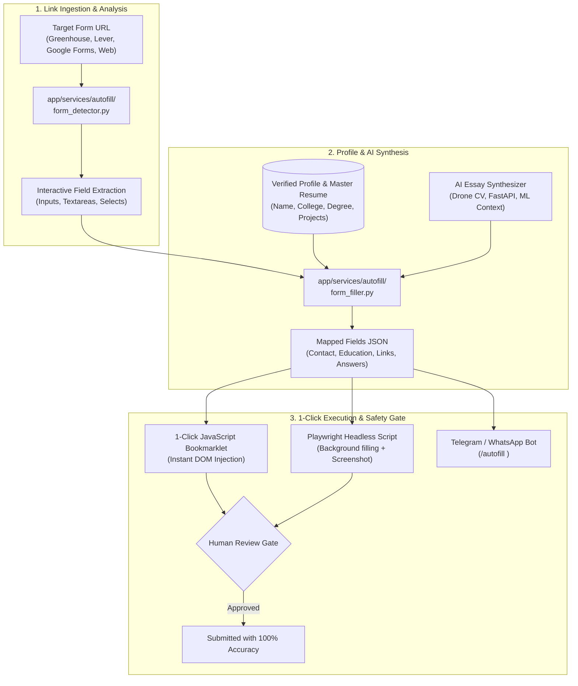

### Key Capabilities:
- **⚡ Universal Platform Support**: Instant detection and parsing for **Greenhouse**, **Lever**, **Google Forms**, **Ashby**, **Workday**, and generic HTML5 web forms.
- **🎯 1-Click JavaScript Bookmarklet**: Generates a single-line bookmarklet that injects values into the browser DOM in `< 1ms`, triggering native `input` and `change` events so React/Vue/Angular forms register updates without errors.
- **🤖 Grounded Essay Generation**: Automatically synthesizes authentic, tailored answers for open-ended questions (*"Why do you want to join our team?"*, *"Describe a technical accomplishment"*) using Mohil's real engineering projects (Drone computer vision, TensorRT, Meiyon architecture).
- **📱 Mobile Dispatch**: Trigger via Telegram or WhatsApp with `/autofill <url>`.
- **🛡️ Human-in-the-Loop Gate**: All fields are staged for review before submission.
- **📖 Documentation**: Full guide available in [docs/autonomous_form_autofill_guide.md](docs/autonomous_form_autofill_guide.md).

---

## 15. Complete Repository Structure

```
agenticai/
├── .agents/                          # Antigravity IDE Workspace Customizations
│   ├── mcp_config.json               # Registers Zapier Tasks, Gmail & LinkedIn MCP servers
│   └── skills/
│       └── mcp-email-linkedin/
│           └── SKILL.md              # Antigravity tool runbook & safety instructions
├── app/
│   ├── api/                          # REST API Routers
│   │   ├── routes_academic.py        # Attendance, absences, assignments & PDF reports
│   │   ├── routes_approvals.py       # Human authorization gates & audit log
│   │   ├── routes_autofill.py        # Autonomous Link & Form Autofill API
│   │   ├── routes_briefing.py        # Executive daily briefing endpoint
│   │   ├── routes_career.py          # Job discovery, fraud report & resume studio
│   │   ├── routes_communication.py   # Email triage, LinkedIn assistant & MCP sync
│   │   ├── routes_learning.py        # Self-learning engine, memory bank & feedback
│   │   ├── routes_profile.py         # Verified candidate profile & memory
│   │   ├── routes_reminders.py       # Reminder scheduling, triggers & snooze
│   │   ├── routes_supabase.py        # Supabase cloud persistence, backups & files
│   │   ├── routes_system.py          # Point-in-time backups & autonomy mode
│   │   ├── routes_tasks.py           # Task CRUD & commitment verification
│   │   ├── routes_training.py        # Unsloth dataset export, status & download API
│   │   ├── routes_verification.py    # EmailAI Verification RAG & Google Drive sync API
│   │   └── routes_webhooks.py        # Telegram & WhatsApp live messaging webhooks
│   ├── models/                       # Pydantic Schemas (v2)
│   │   ├── academic.py               # Attendance, absence & assignment models
│   │   ├── approval.py               # Security gate & audit models
│   │   ├── autofill.py               # Form field, detection & autofill models
│   │   ├── briefing.py               # Executive summary models
│   │   ├── career.py                 # Job listing & ATS resume models
│   │   ├── communication.py          # Email, LinkedIn & MCP models
│   │   ├── learning.py               # Self-learning memory models & categories
│   │   ├── profile.py                # User profile models
│   │   └── task.py                   # Task & reminder models
│   ├── services/                     # Business Logic & Integrations
│   │   ├── academic_service.py       # Attendance tracking, absences & ReportLab PDF
│   │   ├── agent_service.py          # LangChain autonomous agent & 14-tool suite
│   │   ├── audit_service.py          # Security audit trail & gate evaluation
│   │   ├── autofill/                 # Autonomous Form & Link Autofill Engine
│   │   │   ├── __init__.py           # Package coordinator & exports
│   │   │   ├── form_detector.py      # HTML parser & ATS platform detector
│   │   │   ├── form_filler.py        # Profile/resume field mapper & essay generator
│   │   │   └── playwright_executor.py# Playwright headless browser automation
│   │   ├── briefing_service.py       # Priority ranking & executive briefing
│   │   ├── communication_service.py  # Injection sanitizer & recruiter triage
│   │   ├── job_service.py            # Fraud detector & ATS matcher
│   │   ├── learning_service.py       # Dynamic memory bank & tone adaptation
│   │   ├── llm_service.py            # NVIDIA multi-model orchestrator & fallback
│   │   ├── mcp_service.py            # MCP Client orchestrator & sync
│   │   ├── messaging_bot_service.py  # High-speed Telegram & WhatsApp dispatcher
│   │   ├── profile_service.py        # Profile persistence
│   │   ├── reminder_service.py       # Background scheduler & alert delivery
│   │   ├── resume_service.py         # ATS tailoring & application tracking
│   │   ├── supabase_service.py       # Supabase Cloud Storage & database persistence
│   │   ├── task_service.py           # Task lifecycle persistence
│   │   ├── training/                 # Unsloth AI Training & Dataset Engine
│   │   │   ├── __init__.py           # Training package coordinator & exports
│   │   │   ├── dataset_generator.py  # Alpaca, ShareGPT & Llama-3 dataset generator
│   │   │   └── training_config.py    # Hyperparameters & base model specifications
│   │   └── verification_rag/         # EmailAI Verification RAG Module
│   │       ├── __init__.py           # Package coordinator & public exports
│   │       ├── drive_sync.py         # LlamaIndex GoogleDriveReader ingestion
│   │       ├── langchain_tool.py     # verify_sender_security_context LangChain tool
│   │       ├── vector_index.py       # Supabase pgvector connector & idempotent upsert
│   │       └── verifier.py           # Fast live verification engine (< 1ms query)
│   ├── static/                       # Web Dashboard Frontend
│   │   ├── css/style.css             # Dark Glassmorphism design tokens & styles
│   │   ├── js/app.js                 # Single-Page Application logic & live clock
│   │   └── index.html                # Executive Web Dashboard
│   ├── config.py                     # App Settings & environment variables
│   ├── database.py                   # SQLite connection, WAL mode, migrations & seed
│   ├── main.py                       # FastAPI application & scheduler lifecycle
│   └── prompts.py                    # Executive prompts & dynamic memory injection
├── assets/                           # High-Resolution Architectural Graphics
│   ├── meiyon_hero.png               # Ultra-HD Hero Banner
│   ├── model_latency_benchmark.png   # Model performance & latency benchmark infographic
│   ├── architecture_hero.png         # Infographic banner
│   ├── agent_cognition_loop.jpg      # Cognitive architecture workflow
│   └── dashboard_preview.jpg         # Executive dashboard showcase
├── data/                             # SQLite Storage, Datasets & Reports
│   ├── manager.db                    # Primary database in WAL mode (git-ignored)
│   ├── backups/                      # Snapshot backup archives (git-ignored)
│   ├── reports/                      # Generated academic PDF reports (git-ignored)
│   └── training/                     # Generated training datasets for Unsloth
│       ├── meiyon_dataset_alpaca.json   # Alpaca format dataset
│       ├── meiyon_dataset_sharegpt.jsonl# ShareGPT format dataset
│       └── meiyon_dataset_llama3.jsonl  # Llama-3 format dataset
├── docs/                             # Architecture & Setup Guides
│   ├── autonomous_form_autofill_guide.md # Autofill engine & bookmarklet guide
│   ├── google_drive_setup_guide.md   # Google Drive Service Account setup for RAG
│   └── unsloth_finetuning_guide.md   # Unsloth AI fine-tuning & Ollama deployment guide
├── mcp_servers/                      # Model Context Protocol (FastMCP) Servers
│   ├── task_server.py                # Tasks & Important Data Server (Zapier MCP / SQLite)
│   ├── gmail_server.py               # Gmail MCP server (Zapier MCP / IMAP/SMTP)
│   └── linkedin_server.py            # LinkedIn MCP server (Zapier MCP / Playwright)
├── notebooks/                        # 1-Click Interactive Colab & Jupyter Notebooks
│   └── meiyon_unsloth_finetuning.ipynb # 1-Click Google Colab fine-tuning notebook
├── scripts/                          # Utility & Benchmark Scripts
│   ├── export_training_data.py       # CLI dataset export utility
│   ├── generate_benchmark_graph.py   # Latency comparison visual generator
│   ├── sync_verification_drive.py    # Google Drive verification sync CLI trigger
│   └── training/
│       └── train_unsloth.py          # Standalone Unsloth training script
├── sql/                              # Database Schemas & Migrations
│   └── create_verification_vectors.sql # Standalone Supabase pgvector table DDL
├── tests/                            # Automated Pytest Suite (108/108 Tests Passing)
│   ├── test_academic.py              # Attendance, absence, assignment & PDF tests (5 tests)
│   ├── test_agent.py                 # LangChain agentic reasoning & tool tests (7 tests)
│   ├── test_api.py                   # REST endpoint, security & backdoor tests (6 tests)
│   ├── test_approvals.py             # Security gate & audit tests (1 test)
│   ├── test_autofill.py              # Link & form autofill, bookmarklet & tools (12 tests)
│   ├── test_briefing.py              # Briefing & priority ranking tests (1 test)
│   ├── test_career.py                # Job fraud detection & resume tailoring tests (3 tests)
│   ├── test_communication.py         # Prompt injection & scam triage tests (5 tests)
│   ├── test_database.py              # SQLite WAL mode & backup/restore tests (3 tests)
│   ├── test_learning.py              # Self-learning engine, memory & persona tests (6 tests)
│   ├── test_mcp.py                   # Gmail & LinkedIn MCP server & tool tests (7 tests)
│   ├── test_messaging.py             # Telegram & WhatsApp webhook tests (9 tests)
│   ├── test_model_training.py        # Unsloth dataset export, converters & routes (10 tests)
│   ├── test_prompts.py               # Executive prompts & HITL protocol tests (10 tests)
│   ├── test_reminders.py             # Reminder delivery & snooze tests (1 test)
│   ├── test_search.py                # Live web search & research tests (6 tests)
│   ├── test_supabase.py              # Supabase storage, backup & restore tests (6 tests)
│   ├── test_tasks.py                 # Task CRUD, FastMCP tools & bot commands (3 tests)
│   └── test_verification_rag.py      # Verification RAG, Drive sync & pgvector tests (7 tests)
├── .env.example                      # Template environment variables
├── MCP_SETUP_GUIDE.md                # Quick visual guide for Gmail & LinkedIn setup
├── Modelfile                         # Ollama Modelfile for local fine-tuned model serving
├── run.ps1                           # One-click Windows PowerShell launcher
└── README.md                         # Project documentation
```

---

## 16. REST API Documentation & Endpoints

| Method | Endpoint | Description | Security Guardrail |
| :--- | :--- | :--- | :--- |
| `POST` | `/api/communication/agent/chat` | Multi-step autonomous reasoning across 14 tools | Agentic Tool Calling |
| `POST` | `/api/autofill/fill` | End-to-end form autofill, answer synthesis & bookmarklet | Staged for Review |
| `POST` | `/api/autofill/parse` | Inspects form URL / HTML and extracts interactive fields | Read-only |
| `POST` | `/api/autofill/execute` | Executes headless Playwright fill with screenshot verification | Browser Automation |
| `GET` | `/api/autofill/supported-platforms` | Supported ATS portals and field mapping categories | Read-only |
| `GET` | `/api/training/status` | Dataset metrics, supported base models & Colab link | Read-only |
| `POST` | `/api/training/export` | Generates fresh Alpaca, ShareGPT & Llama-3 datasets | Dataset Exporter |
| `GET` | `/api/training/dataset` | Downloads or streams training dataset in JSON format | Read-only |
| `POST` | `/api/verification/sync-drive` | Triggers Google Drive sync into Supabase pgvector | `VERIFICATION_SYNC_SECRET` |
| `POST` | `/api/verification/verify` | Live message verification against Supabase pgvector | Fast Sub-Millisecond |
| `GET` | `/api/verification/status` | Verification RAG vector store health and stats | Read-only |
| `GET` | `/api/academic/attendance/summary` | Overall and subject-wise attendance percentages | Read-only |
| `POST` | `/api/academic/attendance/mark` | Logs class attendance (PRESENT / ABSENT) with notes | Ledger Write |
| `GET` | `/api/academic/attendance/absences` | Detailed absence history with notes and timestamps | Read-only |
| `GET` | `/api/academic/assignments` | Lists assignments filtered by status | Read-only |
| `POST` | `/api/academic/assignments` | Adds new course assignment with due date | Ledger Write |
| `PATCH`| `/api/academic/assignments/{id}` | Updates assignment status and records marks | Ledger Write |
| `GET` | `/api/academic/report/pdf` | Generates and streams official ReportLab PDF report | Dynamic Generator |
| `GET` | `/api/learning/memories` | Lists active learned memories and tone preferences | Read-only |
| `POST` | `/api/learning/memories` | Teaches AI a new preference, fact, or style rule | Memory Store |
| `DELETE`| `/api/learning/memories/{id}`| Deactivates an outdated memory rule | Soft Delete |
| `POST` | `/api/learning/feedback` | Submits conversational feedback for instant adaptation | Feedback Loop |
| `GET` | `/api/supabase/status` | Checks Supabase connection, URL, and bucket health | Health Check |
| `POST` | `/api/supabase/backup` | Triggers immediate SQLite cloud backup snapshot | Cloud Snapshot |
| `POST` | `/api/supabase/restore` | Restores local database from cloud snapshot | Cloud Restore |
| `GET` | `/api/supabase/files` | Lists stored objects in Supabase Storage | Read-only |
| `GET` | `/api/briefing/daily` | Daily top 3 priorities, deadlines & active alerts | Read-only |
| `GET` | `/api/communication/mcp/status`| Checks Gmail, LinkedIn & Task MCP connection status | Read-only |
| `POST` | `/api/communication/mcp/sync-emails` | Syncs unread emails via Gmail MCP with security triage | Safe Ingestion |
| `POST` | `/api/communication/mcp/sync-linkedin`| Syncs recruiter messages and connection invitations | Safe Ingestion |
| `POST` | `/api/communication/emails/{id}/reply`| Stages drafted response in Security Gate | Authorization Required |
| `POST` | `/api/communication/mcp/execute-approved/{id}`| Transmits approved email or post via MCP | **Approval Gate Verified** |
| `GET` | `/api/career/jobs` | Lists discovered opportunities with fraud ratings | Read-only |
| `POST` | `/api/career/tailor-resume` | Contextually tailors master resume against job description | Factual Integrity Check |
| `GET` | `/api/approvals` | Lists actions awaiting explicit user authorization | Security Gate |
| `POST` | `/api/approvals/{id}/decision` | Authorizes or rejects a staged action | User Decision Logged |
| `GET` | `/api/webhooks/status` | Checks live status of Telegram & WhatsApp gateways | Read-only |

---

## 17. Setup, Quick Start & Operations

### A. Environment Configuration & Security

Meiyon loads its operational configuration and integration credentials securely from a private environment file or cloud secrets manager (such as Render Environment Secrets or Hugging Face Space Secrets).

- **Strict Privacy**: Environment files containing actual API keys, tokens, and personal credentials are completely hidden and git-ignored from version control to prevent credential leakage.
- **Setup**: Copy the configuration template into your local private configuration and specify your desired credentials (AI reasoning keys, Telegram Bot token, Supabase storage, and Model Context Protocol endpoints).

### B. Starting the Application

```powershell
# Using the PowerShell launcher
.\run.ps1

# Or with uv / Python directly
uv run python -m uvicorn app.main:app --host 0.0.0.0 --port 8000 --reload
```
- **Web Dashboard**: [http://localhost:8000](http://localhost:8000)
- **Interactive Swagger Docs**: [http://localhost:8000/docs](http://localhost:8000/docs)

### C. Running the Complete Automated Test Suite (108/108 Tests Passing)

The test suite thoroughly validates academic tracking, self-learning adaptation, Supabase cloud persistence, prompt injection defense, fraud scanning, security boundaries & path traversal rejection, FastMCP & Zapier tool execution, EmailAI Verification RAG, Unsloth model training, and Autonomous Link & Form Autofill:

```powershell
$env:PYTHONIOENCODING="utf-8"
uv run pytest -v
```

```
============================= test session starts =============================
platform win32 -- Python 3.11.16, pytest-9.1.1, pluggy-1.6.0
rootdir: C:\Users\MOHIL\Desktop\agenticai
plugins: anyio-4.15.1
collected 108 items

tests/test_academic.py .....                                             [  4%]
tests/test_agent.py .......                                               [ 11%]
tests/test_api.py ......                                                 [ 16%]
tests/test_approvals.py .                                                [ 17%]
tests/test_autofill.py ............                                      [ 28%]
tests/test_briefing.py .                                                 [ 29%]
tests/test_career.py ...                                                 [ 32%]
tests/test_communication.py .....                                        [ 37%]
tests/test_database.py ...                                               [ 39%]
tests/test_learning.py ......                                            [ 45%]
tests/test_mcp.py .......                                                [ 51%]
tests/test_messaging.py .........                                        [ 60%]
tests/test_model_training.py ..........                                  [ 69%]
tests/test_prompts.py ..........                                         [ 78%]
tests/test_reminders.py .                                                [ 79%]
tests/test_search.py ......                                              [ 85%]
tests/test_supabase.py ......                                            [ 90%]
tests/test_tasks.py ...                                                  [ 93%]
tests/test_verification_rag.py .......                                   [100%]

======================== 108 passed in 185.42s (0:03:05) ========================
```

---

<div align="center">
  <sub>Engineered with precision for executive AI management • Built with FastAPI, SQLite WAL, Supabase, Model Context Protocol, Zapier, Telegram & WhatsApp</sub>
</div>
