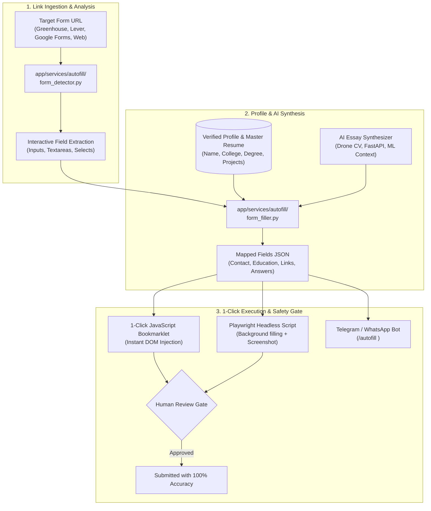

# 📝 Autonomous Link & Form Autofill Engine

Meiyon includes an autonomous **Link & Form Autofill Engine** designed to instantly parse, map, and autofill online job applications, Google Forms, academic submissions, and corporate ATS portals (Greenhouse, Lever, Workday, Ashby) with 100% factual fidelity to Mohil's verified profile and master resume.

---

## 1. How It Works



---

## 2. Core Capabilities

1. **⚡ Universal Platform Support**:
   - **Greenhouse** (`boards.greenhouse.io`, `job-boards.greenhouse.io`)
   - **Lever** (`jobs.lever.co`)
   - **Google Forms** (`docs.google.com/forms`, `forms.gle`)
   - **Ashby** (`jobs.ashbyhq.com`)
   - **Workday** (`*.myworkdayjobs.com`)
   - **Generic HTML5 `<form>` pages**

2. **🎯 Factual Grounding**:
   - Personal details, academic standing at *Mar Baselios Christian College of Engineering & Technology*, expected graduation (*2027*), and verified social links (*LinkedIn*, *GitHub*) are retrieved straight from the local SQLite database.

3. **🤖 Intelligent Essay Generation**:
   - For custom application essays (e.g., *"Why do you want to join our team?"*, *"Describe a challenging technical project you built"*), Meiyon dynamically synthesizes authentic answers highlighting Mohil's real achievements:
     - Real-time YOLO aerial object detection with TensorRT FP16 quantization (45+ FPS on edge hardware)
     - Meiyon autonomous executive AI manager (FastAPI, SQLite WAL, multi-agent orchestration)

4. **🛡️ 1-Click Browser Bookmarklet**:
   - Generates an executable single-line bookmarklet:
     ```javascript
     javascript:(function(){ ... })();
     ```
   - Dispatches native `input` and `change` browser events so modern frontend frameworks (**React**, **Vue**, **Angular**) register every field update in `< 1ms`.

5. **📱 Mobile Bot Commands**:
   - Send `/autofill <url>` in Telegram or WhatsApp to instantly receive the field breakdown and pre-filled answers.

---

## 3. REST API Reference

| Method | Endpoint | Description |
| :--- | :--- | :--- |
| `POST` | `/api/autofill/parse` | Inspects a form URL or raw HTML and returns detected fields |
| `POST` | `/api/autofill/fill` | End-to-end: parses form, matches profile, generates tailored answers, and produces bookmarklet |
| `POST` | `/api/autofill/execute` | Executes headless Playwright browser to populate live page and capture screenshot |
| `GET` | `/api/autofill/supported-platforms` | Returns list of recognized ATS portals and supported field categories |
